# SeatLock

[](https://github.com/GopiSVDev/seat-lock/actions/workflows/ci.yml)

A movie ticket booking system (in the spirit of BookMyShow or Ticketmaster), backend and website, built to
answer one question:
**how do you never sell the same seat twice when thousands of people try to book at once?**

Customers browse movies and shows, hold seats for 5 minutes, pay through Razorpay (test mode) and get a
confirmation. It started deliberately simple; each improvement was made only after a test showed a real
problem.

## Highlights

- **0 seats sold twice** in every test: a guarded `UPDATE ... WHERE status = 'AVAILABLE'` decides who gets a
  seat, and a partial unique index refuses a double sale even if the code had a bug.
- **Flash sale with payments:** 2,025 paid bookings in 60 s, 5,000 of 5,000 seats sold, 0 failed requests,
  every booking announced exactly once ([details](#flash-sale-with-payments)).
- **Seat holds in Redis:** atomic Lua scripts hold all seats or none, expire by TTL, and are rate limited per
  user with a token bucket (Bucket4j) shared across instances.
- **Real payments:** Razorpay orders, HMAC-verified Checkout results and webhooks, automatic refunds when
  the seats were lost, idempotent at every step.
- **Microservices:** API gateway (Spring Cloud Gateway), payment service, notification service; services
  call each other with their own Keycloak client-credentials tokens.
- **Resilience:** timeouts, a bulkhead and a circuit breaker (Resilience4j) keep a slow payment provider
  from taking the whole backend down.
- **Events:** transactional outbox → Kafka → idempotent consumer, so a confirmed booking is never lost or
  announced twice.
- **Performance on 1 vCPU / 2 GB:** seat map 710 → 4,150 views/s, bookings 470 → 960/s, each step
  measured with k6.
- **A website for every flow:** city search, movies with real posters, showtimes, a live seat map (pick how
  many seats, one tap selects them side by side), Razorpay Checkout with a payment countdown, e-tickets, my
  bookings and admin pages with a visual screen builder ([screenshots](#the-website)).
- **160 automated tests** (129 on the JVM with Testcontainers' real PostgreSQL, Redis and Kafka, WireMock and
  ArchUnit, **94% line coverage**; 31 for the website) plus a Playwright smoke test in a real browser, run by
  GitHub Actions on every pull request.

**Stack:** Java 25, Spring Boot 4 (Web MVC, Data JPA, Security, Kafka), Spring Cloud Gateway, PostgreSQL 16,
Flyway, Redis 8, Kafka 4 (KRaft), Keycloak 26 (OAuth2/OIDC, JWT), Resilience4j, Bucket4j, Razorpay, Docker
Compose, Testcontainers, WireMock, JUnit 5, k6, GitHub Actions. Website: React 19, TypeScript, Vite, React
Router, TanStack Query, oidc-client-ts, nginx, Vitest, Testing Library, Playwright.

- [What it does](#what-it-does)
- [Quick start](#quick-start)
- [The website](#the-website)
- [Architecture](#architecture)
- [How a booking works](#how-a-booking-works)
- [Data model](#data-model)
- [Performance](#performance)
- [Tests](#tests)
- [Project layout](#project-layout)
- [Not built](#not-built)

New here? **[docs/story.md](docs/story.md)** explains the whole app as a story about a cinema, no
programming needed. API reference with request and response examples: **[docs/api.md](docs/api.md)**.

## What it does

1. An admin adds **movies**, **theatres** and **screens** (rows of seats, each row REGULAR, PREMIUM or
   RECLINER). Every theatre is in a **city** from a fixed list; city search forgives typos and old names
   ("chenai", "Madras" → Chennai).
2. The admin schedules a **show** (a movie on a screen at a time, with a price per seat type). Every seat
   of the screen becomes a bookable **show seat**.
3. A customer opens the **seat map**: the layout (never changes) plus availability (taken right now).
4. The customer **holds** seats for 5 minutes: the exact seats they picked, or "best available N seats of a
   type", where the server picks the best adjacent block. Held seats can't be taken by anyone else.
5. The customer **checks out** (the hold is kept for a 10-minute payment window) and **pays** with Razorpay.
   Only a verified payment books the seats. Money that arrives after the seats were lost is refunded;
   unpaid bookings expire.
6. The **notification service** hears about every confirmed booking through Kafka and "emails" the customer.
   Customers list, open and cancel (with a refund) their own bookings.

28 public endpoints under `/api/v1` plus one internal one, all JSON over HTTP; errors use
[RFC 9457 problem details](https://www.rfc-editor.org/rfc/rfc9457).

| Area | Endpoints |
|---|---|
| Catalogue | `GET /api/v1/cities`, `GET /api/v1/cities/{id}`, `POST /api/v1/cities`, `POST /api/v1/cities/{id}/aliases`, `GET /api/v1/movies`, `POST /api/v1/movies`, `GET /api/v1/movies/{id}`, `GET /api/v1/theatres`, `POST /api/v1/theatres`, `GET /api/v1/theatres/{id}`, `GET /api/v1/theatres/{id}/shows`, `POST /api/v1/theatres/{id}/screens`, `GET /api/v1/screens/{id}`, `GET /api/v1/shows`, `POST /api/v1/shows`, `GET /api/v1/shows/{id}` |
| Seat map | `GET /api/v1/shows/{id}/layout`, `GET /api/v1/shows/{id}/availability` |
| Holds | `POST /api/v1/holds`, `POST /api/v1/holds/best-available`, `GET /api/v1/holds/{id}`, `DELETE /api/v1/holds/{id}` |
| Booking | `POST /api/v1/bookings` (checkout), `POST /api/v1/bookings/{id}/payment`, `GET /api/v1/bookings`, `GET /api/v1/bookings/{id}`, `POST /api/v1/bookings/{id}/cancel` |
| Internal (payment service only) | `POST /internal/bookings/{id}/paid` |

`GET` on catalogue and seat maps is public, creating catalogue data needs the `ADMIN` role, holds and
bookings need a logged-in user. Logins come from **Keycloak**; every service checks the JWT on every request
([details](docs/api.md#authentication)). A booking belongs to the user who made it (the token's `sub`);
anyone else's booking answers `404`.

## Quick start

Everything runs in Docker.

```bash
cp .env.example .env            # credentials, ports, Razorpay test keys (no defaults in the app)
docker compose up --build -d    # website :5173, API gateway :8080, Keycloak :8180, PostgreSQL :5433
docker compose ps               # every service healthy
```

Open **[localhost:5173](http://localhost:5173)** and sign in as `asha`/`asha` (or `admin`/`admin` for the admin
pages). An empty database has no shows yet; add November 2026 releases (posters, runtimes and dates from
their Wikipedia pages), ten real cinemas in five cities and five days of shows, through the API as admin:

```bash
docker run --rm --network host -v "$PWD/web":/app -w /app node:24.11.0-alpine node scripts/demo-data.mjs
```

This starts PostgreSQL, Redis, Kafka, Keycloak, the backend, the payment and notification services, the
API gateway and the website in dependency order. On a new Postgres volume init scripts create the payment and notification
databases; on a new Keycloak volume the realm is imported. After pulling changes to either, start over from
empty volumes (this **deletes all data**):

```bash
docker compose down && docker volume rm -f seat-lock_postgres_data seat-lock_keycloak_data && docker compose up --build -d
```

Walk through the flow (ids assume an empty database; tokens from Keycloak's dev-only password login last
1 hour):

```bash
B=localhost:8080/api/v1
token() { curl -s localhost:8180/realms/seatlock/protocol/openid-connect/token -d grant_type=password \
  -d client_id=seatlock-dev-cli -d username=$1 -d password=$1 | jq -r .access_token; }
ADMIN="Authorization: Bearer $(token admin)"
ASHA="Authorization: Bearer $(token asha)"

curl -s -XPOST $B/movies -H "$ADMIN" -H 'Content-Type: application/json' \
  -d '{"title":"Interstellar","durationMinutes":169,"certification":"UA","releaseDate":"2014-11-07",
       "posterUrl":"https://cdn.example.com/posters/interstellar.jpg","genres":["SCI_FI","DRAMA"]}'
curl -s "$B/cities?query=chenai"   # typo tolerant: Chennai, id 5
curl -s -XPOST $B/theatres -H "$ADMIN" -H 'Content-Type: application/json' \
  -d '{"name":"PVR Grand","cityId":5,"address":"1 Main Road"}'
curl -s -XPOST $B/theatres/1/screens -H "$ADMIN" -H 'Content-Type: application/json' \
  -d '{"name":"Screen 1","rows":[{"label":"A","seatCount":10,"seatType":"REGULAR"},
                                 {"label":"B","seatCount":10,"seatType":"REGULAR"},
                                 {"label":"C","seatCount":8,"seatType":"RECLINER"}]}'
curl -s -XPOST $B/shows -H "$ADMIN" -H 'Content-Type: application/json' \
  -d '{"movieId":1,"screenId":1,"startTime":"2030-01-01T13:30:00Z","language":"ENGLISH","format":"IMAX_2D",
       "prices":{"REGULAR":15000,"RECLINER":40000}}'   # 7:00 PM in India; prices in paise (₹150, ₹400)

curl -s $B/shows/1/layout          # rows and seat ids
curl -s $B/shows/1/availability    # which seat ids are taken

HOLD=$(curl -s -XPOST $B/holds -H "$ASHA" -H 'Content-Type: application/json' \
  -d '{"showId":1,"showSeatIds":[1,2]}' | jq -r .id)     # A1, A2 held for 5 minutes (totalAmount 30000 = ₹300)
curl -s -XPOST $B/holds/best-available -H "$ASHA" -H 'Content-Type: application/json' \
  -d '{"showId":1,"quantity":2,"seatType":"RECLINER"}'   # the server picks 2 adjacent recliners
echo "$HOLD"; echo "${ASHA#Authorization: Bearer }"     # paste both into localhost:8080/dev/checkout.html, pay
curl -s -H "$ASHA" $B/bookings/1   # CONFIRMED once paid
curl -s -XPOST -H "$ASHA" $B/bookings/1/cancel   # refunded, seats A1, A2 back on sale
curl -s -H "$ASHA" $B/bookings     # Asha's upcoming bookings (?period=PAST for past)
curl -s "$B/movies?cityId=5"       # now showing in Chennai
curl -s "$B/shows?movieId=1&cityId=5&date=2030-01-01"   # its shows that day, by theatre
curl -s "$B/theatres/1/shows?date=2030-01-01"            # what's playing at one cinema, by movie
docker compose logs notification | grep "Email to"       # the confirmation, sent through Kafka
```

Paying needs a browser: Razorpay Checkout is a widget. The website does it; so does `/dev/checkout.html` (a
dev-only page served by the backend: paste a token and a hold id). The payment service needs Razorpay
test keys in `.env` ([below](#running-it-with-razorpay-test-mode)).

Test users in the `seatlock` realm: `admin`/`admin` (ADMIN), `asha`/`asha` and `ravi`/`ravi` (CUSTOMER); new
sign-ups get CUSTOMER. Keycloak's admin console is at [localhost:8180/admin](http://localhost:8180/admin)
(credentials from `.env`). Local development credentials only.

**Bruno collection:** [collections/seatlock.bruno.json](collections/seatlock.bruno.json) has 77 requests with
tests (log in, cities, admin setup, browsing, seat map, holds, checkout and payment, security checks that must
fail). Import it in [Bruno](https://www.usebruno.com/), pick the `local` environment, set its secret
`webhookSecret` to your `RAZORPAY_WEBHOOK_SECRET`, and run it. Bookings are paid with a **simulated, signed
Razorpay webhook**, so the real chain runs (signature check, payment service, service token, internal callback).

**Swagger UI** at [localhost:8080/swagger-ui.html](http://localhost:8080/swagger-ui.html) (OpenAPI spec at
`/v3/api-docs`); its **Authorize** button logs in through Keycloak (authorization code with PKCE).

## The website

`web/` is a React + TypeScript single-page app, built by Vite and served by **nginx** on `:5173`. nginx also
proxies `/api/` and `/v3/api-docs` to the API gateway, so the browser talks to one origin and the backend needs
no CORS. Logins go to Keycloak (client `seatlock-web`, authorization code with PKCE); tokens last 5 minutes
and are renewed silently with the refresh token, and a `401` renews once, then logs in again. Admin pages are
shown only to the `ADMIN` role; the API still checks every call. API types are generated from the OpenAPI
spec (`npm run gen:api`, kept in `src/api/schema.d.ts`).

**Design.** A light, quiet interface that lets the posters carry the colour: Onest (one variable typeface,
tabular figures for times and prices), near-black ink on white, one red accent for actions, green for seats
and showtimes, and no animation anywhere. The flow is the one people know from ticketing apps: city, movie,
date and showtime, how many seats, seat map, review and pay, e-ticket. Posters lazy-load with fixed 2:3
boxes (no layout shift); browsing pages are in the main bundle while checkout, bookings and admin load on
first use; hovering a movie or a showtime prefetches the next page's data; nginx gzips text and caches
hashed assets forever.

| Flow | What the site does |
|---|---|
| City | typo-tolerant search ("chenai", "madras" → Chennai), popular cities, remembered in the browser |
| Movies | posters, language / format / genre filters, paging |
| Movie, cinema | India-time date strip, showtimes grouped by cinema or by movie |
| Seat map | "how many seats?" (1 to 10), then one tap selects that many side by side (a tap on a selected seat unselects it, a tap elsewhere moves the block); "best available" per section; back rows on top, screen at the bottom; layout + availability polled every 4 s; zoom; live total in ₹ |
| Continue | reserves the seats (`POST /holds`), signing in first if needed (the selection survives the trip to Keycloak and carries on by itself); `409` names the seats someone else just booked and marks them on the map; `429` counts down `Retry-After` |
| Review and pay | booking summary, a 10-minute countdown, Razorpay Checkout closing a minute before the window ends; declined payment, closed window, `502`, `503` + `Retry-After` and an expired window each explained; leaving the page releases the seats |
| Tickets, my bookings | e-ticket for every status with a booking id, upcoming / past tabs, cancel with a dialog explaining the refund (`409` once the show started) |
| Admin | movies (poster URL, genres, certificate), cinemas, a screen builder with a live preview, shows with a price per seat type, city names; each `400` field error shown next to its field |

Accessibility: every seat is a button with a spoken label ("D8, Regular ₹180, sold"), states differ by fill
and number as well as colour, one seat is in the tab order and arrows move between the rest, focus is always
visible, and the payment countdown announces each minute.

| | |
|---|---|
| 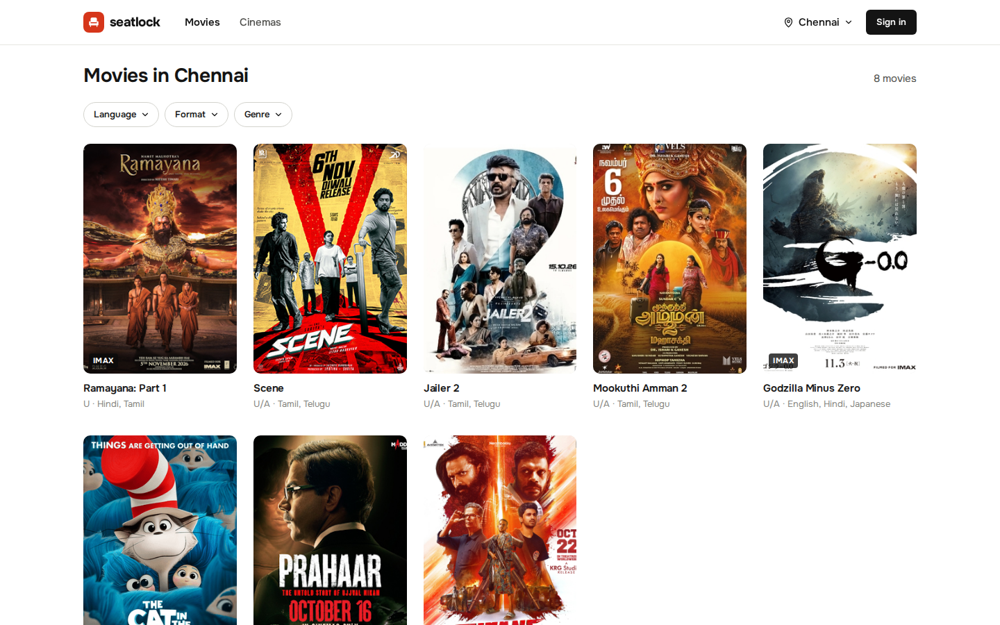 | 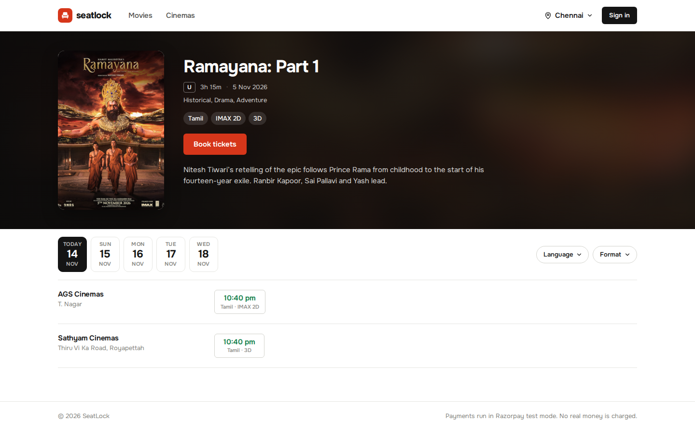 |
| Movies in Chennai | A movie and its showtimes by cinema |
| 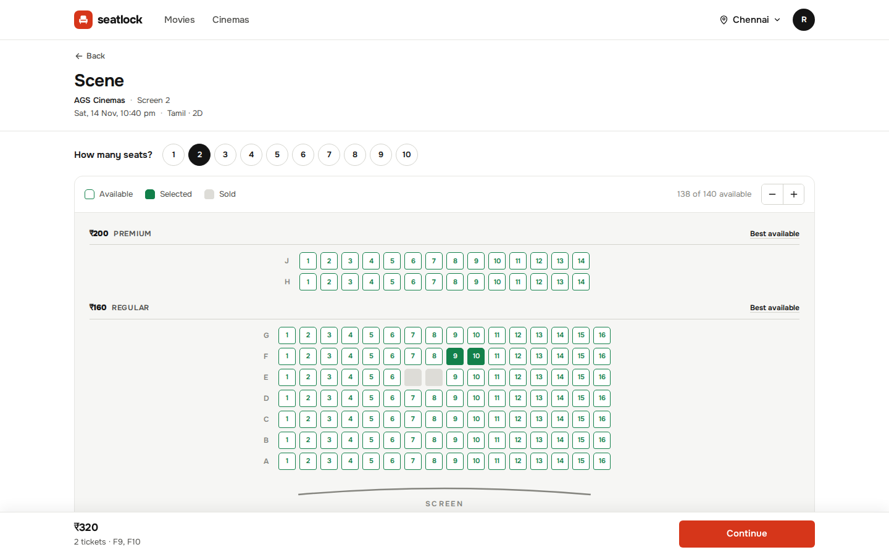 | 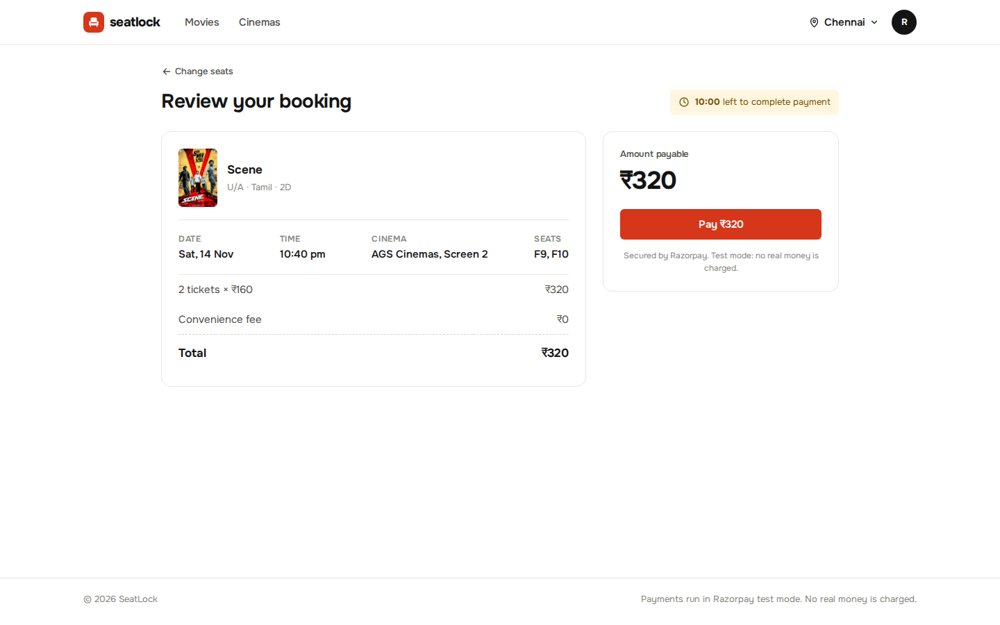 |
| Two seats wanted: one tap selected F9 and F10 | Review and pay, with the payment countdown |
| 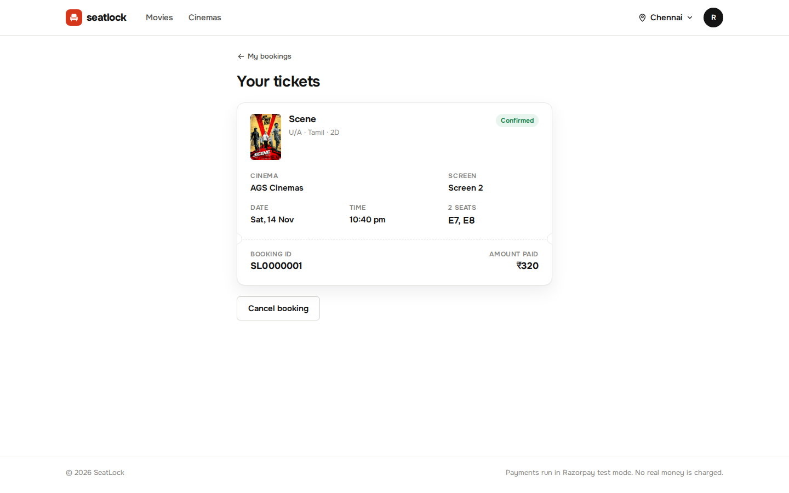 | 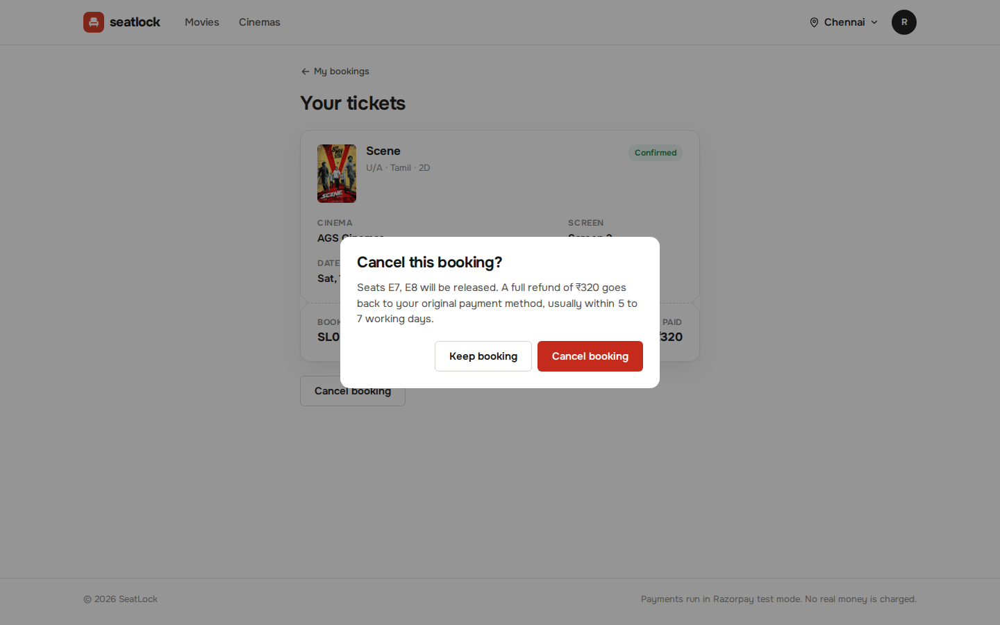 |
| Paid in Razorpay test mode: the e-ticket | Cancelling explains the refund first |
| 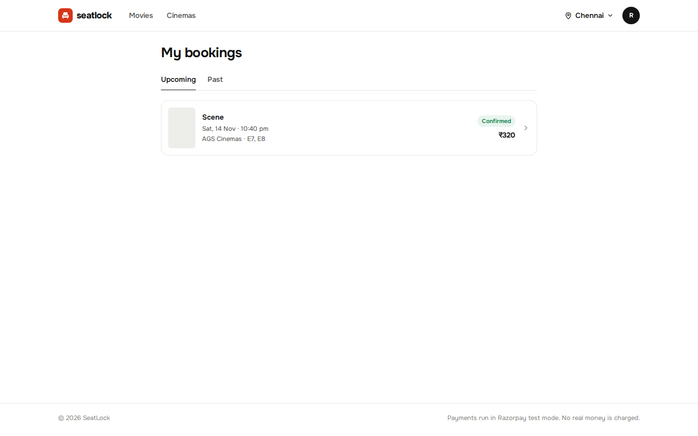 | 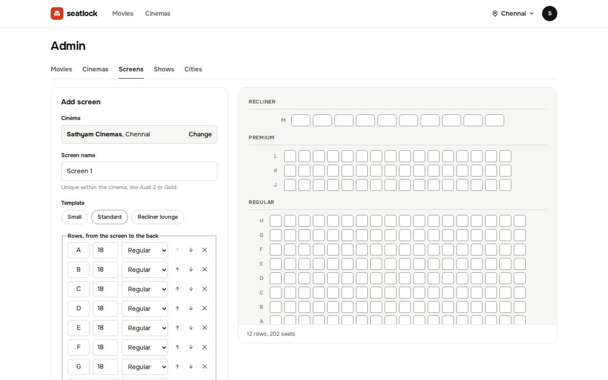 |
| My bookings | Admin: building a screen with a live preview |

On a phone:

| | | | |
|---|---|---|---|
| 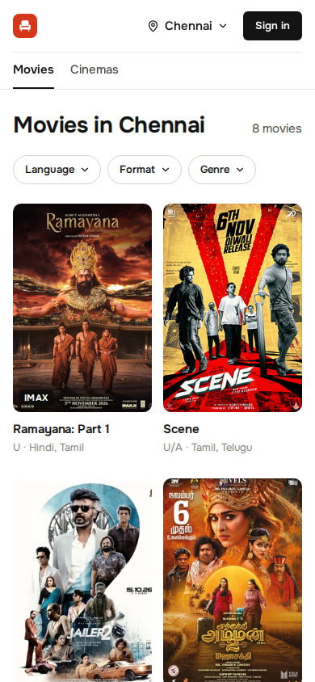 | 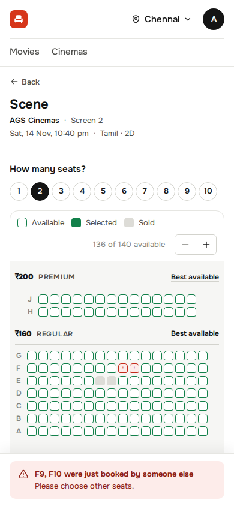 | 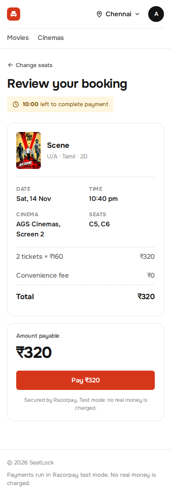 | 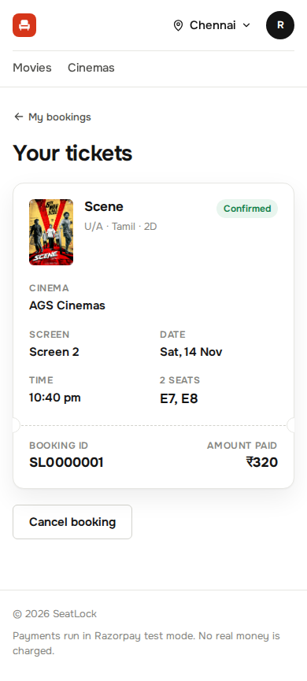 |

What the website works around, because the API doesn't offer it: a seat map page finds its cinema's name
through `GET /screens/{id}` and `GET /theatres/{id}` (the show has no theatre); the admin pages can't list a
cinema's screens, so the show form takes a screen id and remembers screens built in that browser; after a page
refresh, checkout gets its Razorpay order again by repeating `POST /bookings` with the same hold (the API
returns the same booking and order).

## Architecture

A modular monolith (the backend, three modules) plus three small services and the website: the **API gateway** in front,
the **payment service** that talks to Razorpay, and the **notification service** that only listens to Kafka.
Payment was split out first: it holds the provider's secrets, talks to an outside system that can be slow or
down, and keeps its own database.

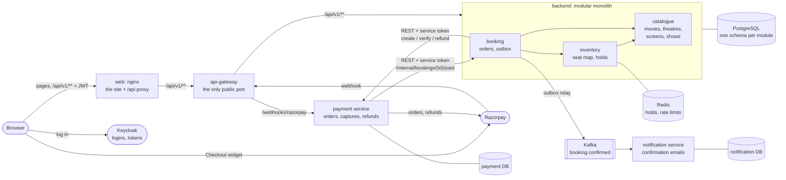

| Part | Owns | Public API | Endpoints |
|---|---|---|---|
| **catalogue** (module) | movies, theatres, screens, physical seats, shows, prices | `CatalogueApi`, `ShowSummary`, `ShowScheduled` event | catalogue |
| **inventory** (module) | `show_seat` (every seat of every show: AVAILABLE / BOOKED); seat holds in Redis | `InventoryApi`, `ConfirmedHold`, `BookedSeat` | seat map, holds |
| **booking** (module) | bookings, their seats, the outbox | `BookingConfirmed` on Kafka | bookings, internal paid callback |
| **payment** (service) | payments, attempts, refunds (database `payment`) | REST, service tokens only | `/payments/**`, `/webhooks/razorpay` |
| **notification** (service) | sent notifications (database `notification`) | none: consumes `booking.confirmed` | none |
| **api-gateway** (service) | nothing: routes requests | none | everything public |
| **web** (nginx) | the website's static files | the pages | proxies `/api/` and `/v3/api-docs` to the gateway |

### The API gateway

`api-gateway` (Spring Cloud Gateway, Server Web MVC) is the **only published app port**. The other services
listen inside Docker only, so the gateway decides what the world can reach:

| Path | Goes to |
|---|---|
| `/api/v1/**` | backend: the public API |
| `/swagger-ui.html`, `/swagger-ui/**`, `/v3/api-docs/**`, `/dev/**` | backend: API docs, dev checkout page |
| `POST /webhooks/razorpay` | payment service: the only public payment endpoint |
| anything else (`/internal/**`, `/payments/**`, `/actuator/**`, ...) | nowhere: `404` |

Paths, headers and bodies pass unchanged (the webhook's signature covers the raw bytes); services learn the
caller's address from `X-Forwarded-For`. A service that is down answers `502`, one slower than 10 s `504`.
Token checks and rate limits at the edge are not built: every service checks tokens itself.

### Module rules

**Dependencies point one way:** booking → inventory → catalogue, and booking → catalogue; nothing depends on
booking. Each module is a package under `com.seatlock.backend` with a small public API on top and everything
else in `internal/`:

```
catalogue/
├── CatalogueApi.java           ← public: other modules may import these
├── ShowSummary.java
├── ShowScheduled.java
└── internal/                   ← private, split by feature (city/, movie/, theatre/, screen/, show/, each with dto/)
```

Single-feature modules (inventory, booking) split `internal/` by layer: `domain/`, `repository/`,
`service/`, `web/`. No module imports another's `internal` package; modules reference each other's data by
plain id only (no JPA relations or foreign keys across schemas). `ArchitectureTest` (ArchUnit) fails the build
if a class breaks these rules.

**How the modules connect:**
- **Scheduling a show:** catalogue saves it and publishes `ShowScheduled` with the screen's seats; inventory
  creates one `show_seat` per seat in the same transaction (copying row, number, type, rank and price), so a
  show never exists without its seats and inventory serves the seat map alone.
- **Checkout:** booking asks `InventoryApi` to keep the hold for the payment window and `CatalogueApi` for the
  show's details, then stores an unpaid booking with a copy of them, so "my bookings" never asks catalogue.
- **Confirming:** `InventoryApi.confirmHold` marks the seats BOOKED in the same transaction that confirms
  the booking; the hold leaves Redis only after the commit.
- **Cancelling:** a guarded update (`... where status = 'CONFIRMED' and show_start_time > now`) picks one
  winner; only that request releases the seats. A double-tapped cancel releasing twice could otherwise free a
  seat someone else had booked in between.

`shared/` holds cross-cutting code: the error handler and exception types (`NotFoundException` → 404,
`ConflictException` → 409, `DownstreamException` → 502, `ServiceUnavailableException` → 503 with
`Retry-After`, ...), security, request logging and the Redis-backed `RateLimiter`.

**Service-to-service calls carry their own tokens.** The backend and the payment service are confidential
Keycloak clients and get tokens with the client credentials grant (cached until they expire). Each token
names one role and one audience: the payment service accepts only `PAYMENTS_CLIENT` tokens minted for it, the
backend's `/internal/**` only `BOOKING_CALLBACK`. A user's token can call neither.

## How a booking works

This is the core of the project. Buying has three steps, as on any ticket site: **hold** the seats for 5
minutes, **check out** (the hold is kept for a 10-minute payment window), then **pay**. Only a verified
payment books the seats.

### Two stores, two jobs

| | Redis | PostgreSQL |
|---|---|---|
| Holds | seat holds with a 5-minute TTL | nothing |
| Sold seats | nothing | `show_seat.status`: AVAILABLE or BOOKED |
| If it loses data | a buyer loses their hold and picks again | not acceptable: the source of truth |

Holds need no cleanup job: Redis expires the keys. The seat map shows a seat as taken if Postgres says
BOOKED or Redis holds it.

### Holding seats: `POST /api/v1/holds`

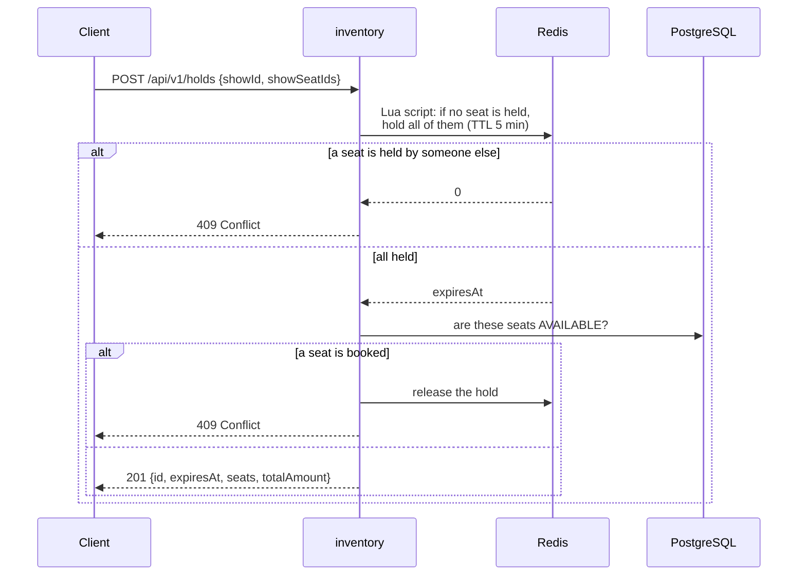

- **All or nothing.** The Lua script runs inside Redis as one atomic step: every seat gets its key
  `seat:{show}:{seat}` or none does. Two buyers can never each get half of a row.
- **Hold first, then check Postgres.** Booking deletes a hold's keys only *after* BOOKED is committed, so any
  earlier booking of those seats is visible to the check that follows a new hold. Checking first would leave a
  gap between the check and the hold.
- **One hold per user per show.** A new hold replaces the previous one, as when a buyer goes back and picks
  other seats.
- **Rate limited per user.** Both hold endpoints share a token bucket per user (Bucket4j): 10 tokens,
  refilled at 10 per minute, then `429` with `Retry-After`. Keyed by the JWT's user id, not the IP (mobile
  carriers put thousands of phones behind one IP). The buckets live in Redis, so several backend instances
  still give 10, not 10 each. If Redis is down the limit is skipped: it protects capacity, it never decides who
  gets a seat.

### Best available: `POST /api/v1/holds/best-available`

In a rush, most buyers want "2 good seats together" and aim at the same centre seats, so exact-seat requests
collide. Best available lets the server choose: every seat has a **rank** (1 = nearest the sweet spot, 60% of
the way back, centre of the row), inventory reads the available seats of the type by rank (no row locks),
drops the ones held in Redis, finds the best block of N adjacent seats in one row (lowest total rank) and holds
it with the same Lua script, retrying up to 3 times if someone was faster. No block left:
`409 No N adjacent <type> seats available`.

### Paying: checkout, Razorpay and the webhook

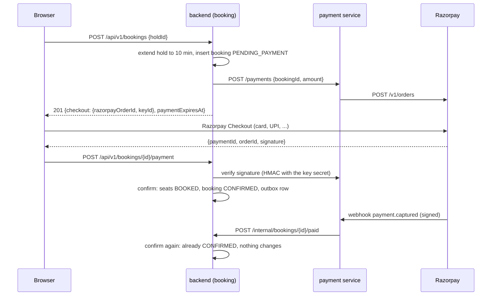

- **Seats are booked only after the money is verified.** Booking first and charging second would leave unpaid
  seats BOOKED whenever a buyer walks away.
- **No transaction waits on another service.** The booking is inserted, then the payment service is called
  outside any transaction, so a database connection is never held while Razorpay answers.
- **Two paths, one confirm.** The browser reports the payment for an instant result; Razorpay's webhook
  reports it even if the buyer closed the tab. Both end in the same guarded update
  (`... where status in ('PENDING_PAYMENT', 'EXPIRED')`), so the second changes nothing. If the backend is down,
  the payment service answers the webhook with 5xx and Razorpay delivers it again.
- **Signatures, not trust.** Checkout results are checked with an HMAC of `order_id|payment_id`, webhooks with
  an HMAC of the raw body, using secrets only Razorpay and the payment service know. A forged "paid" is a 400.
- **Paid, but the seats are gone** (the hold expired or was replaced): the booking becomes `FAILED` and the
  money is refunded. Cancelling a paid booking refunds it too.
- **Unpaid bookings expire.** A job runs every 30 s (`update ... set status = 'EXPIRED' where status =
  'PENDING_PAYMENT' and payment_expires_at < now()`, a partial index keeps it to pending rows); with several
  instances the guarded update still expires each row once.
- **Idempotent everywhere.** One booking per hold, one payment (one Razorpay order) per booking, one refund per
  payment, webhook handlers that can run twice.

Booking states: `PENDING_PAYMENT → CONFIRMED → CANCELLED`, `PENDING_PAYMENT → EXPIRED` (unpaid),
`PENDING_PAYMENT / EXPIRED → FAILED` (paid but seats lost, refunded). Payment states: `CREATED → CAPTURED →
REFUND_PENDING → REFUNDED`; failed card attempts are recorded and keep the order open. A refund stays
`REFUND_PENDING` until Razorpay's `refund.processed`, which comes only when the bank has credited the money
(days).

**Known gap:** if a payment is captured but the browser report and every webhook delivery are lost, or a refund
request fails, nothing retries. A reconciliation job comparing our payments with Razorpay's would close it.

#### Running it with Razorpay test mode

Put the test Key ID and Key Secret in `.env` (`RAZORPAY_KEY_ID`, `RAZORPAY_KEY_SECRET`) plus a webhook secret
of your own (`RAZORPAY_WEBHOOK_SECRET`). Razorpay's webhook needs a public HTTPS URL; a Cloudflare quick
tunnel to the gateway gives one (no account needed):

```bash
docker compose --profile tunnel up -d tunnel
docker compose logs tunnel | grep -o 'https://[a-z0-9-]*\.trycloudflare\.com'
```

The URL changes on every start: in the Razorpay dashboard (test mode, Settings → Webhooks) set URL = tunnel URL
+ `/webhooks/razorpay`, secret = `RAZORPAY_WEBHOOK_SECRET`, events `payment.captured`, `payment.failed`,
`refund.processed`. Without the tunnel the browser path still works; only the webhook backup is missing.
Deliveries show in `docker compose logs -f payment | grep -E 'webhooks|Razorpay event'`.

### When the payment service is slow or down

Every checkout waits on the payment service and holds one of the backend's request threads. Unprotected, a
slow payment service would hold all of them and even the seat map would stop answering
(`PaymentResilienceTest` proved this before the fix). Three Resilience4j guards in `PaymentClient`:

- **Timeouts shrink inwards:** gateway 10 s → backend waits 7 s for the payment service → it waits 5 s for
  Razorpay, so the inner error reaches the caller instead of a gateway 504.
- **Bulkhead:** at most `PAYMENT_MAX_CONCURRENT_CALLS` (50 of 200 threads) payment calls at once, no queue;
  the next gets `503 Payments are busy` with `Retry-After: 5` at once, leaving threads for browsing and holds.
- **Circuit breaker:** if half of the last 10 calls failed or took over 3 s, the backend stops calling for
  30 s and answers `503 Payments are unavailable, try again in N seconds` without waiting; 2 trial calls then
  decide whether it closes. A `4xx` (say, a forged signature) is a bad request, not a sick service, so it
  doesn't count. Refunds go through the breaker but not the bulkhead, so busy checkouts never block a refund.

State changes are logged and exported to Prometheus (`resilience4j_circuitbreaker_state`, ...). Cancel calls
the refund only after its transaction has returned the database connection.

### Confirming a paid booking

1. A Lua script checks the hold belongs to the buyer and keeps its keys alive for at least 60 more seconds,
   so the hold can't expire mid-confirm.
2. In one transaction: the booking's guarded update to CONFIRMED, the seats'
   `UPDATE show_seat SET status = 'BOOKED' WHERE id IN (...) AND status = 'AVAILABLE' RETURNING ...`, and the
   outbox row.
3. After the commit, the hold's keys are deleted.

**Why a seat is never sold twice, even if Redis fails.** The guard `AND status = 'AVAILABLE'` decides, not
Redis. PostgreSQL locks each row it updates, so of two requests racing for seat A5 the second waits, re-checks,
finds it BOOKED and updates nothing; fewer rows than seats means 409 and a rollback. If Redis forgot every hold,
the worst case is an annoyed buyer, never a double sale. **Safety net:** a partial unique index allows at most
one CONFIRMED booking per show seat, so even a bug in the code couldn't sell a seat twice.

### Telling other services: the outbox and Kafka

The notification service confirms each booking to the customer. Calling it over HTTP would make confirming
depend on it; sending a Kafka message after the commit loses it if the backend dies in between, and sending
before announces a booking that may roll back (the dual-write problem). So:

1. **Transactional outbox.** The `BookingConfirmed` event is inserted into `booking.outbox` in the same
   transaction that confirms the booking: both commit or neither does.
2. **Relay.** Every 500 ms a job takes unsent rows (`FOR UPDATE SKIP LOCKED`, so with two instances each row
   goes out once), sends them to topic `booking.confirmed` (key = booking id, so one booking's events stay in
   order) and marks them sent. If Kafka is down the rows wait; confirming never waits on Kafka.
3. **At least once, handled once.** A crash between sending and marking sends a row again. The notification
   service stores each `eventId` under a unique constraint first (`ON CONFLICT DO NOTHING`), so a repeat is
   skipped and the customer gets one email.

The "email" is a log line: `docker compose logs -f notification`.

### The seat map: built for many readers

Viewing the map is far more frequent than booking, so it is split in two:

| | `GET /api/v1/shows/{id}/layout` | `GET /api/v1/shows/{id}/availability` |
|---|---|---|
| Content | rows, seat ids, numbers, types, prices | count of free seats + ids of taken seats |
| Changes | never (for a show) | on every hold and booking |
| Caching | `Cache-Control: public, max-age=86400, immutable` (browsers, CDNs) + in-app cache | in-app cache for 1 second |
| Size | ~6 KB for 250 seats | ~50 bytes to ~2 KB |

Both are cached as ready-made JSON bytes (Caffeine), so a hit skips the database and serialization.
Availability can be up to 1 s stale, which is safe: a hold re-checks every seat, so a stale map can only cause a
409, never a double sale.

## Data model

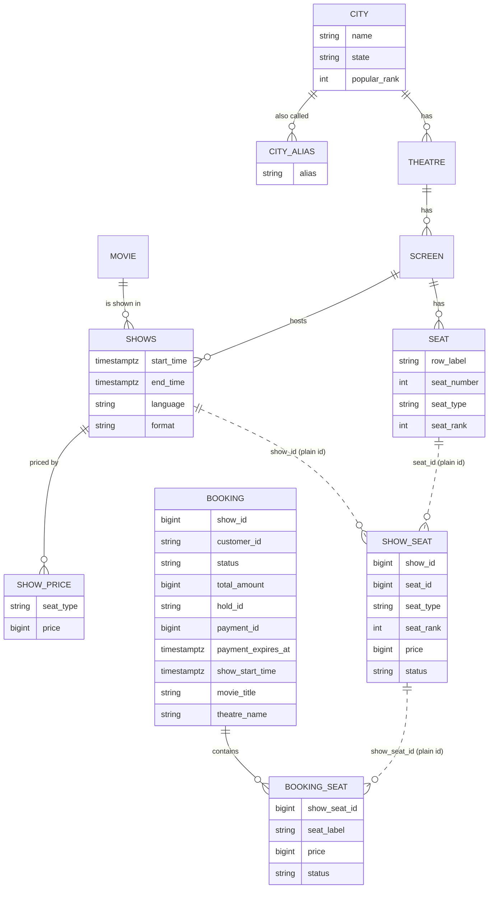

Solid lines are foreign keys inside a schema; dotted lines are plain ids across modules.

- **Seat vs show seat.** `seat` (catalogue) is the physical chair; `show_seat` (inventory) is that chair for one
  show. Booking changes AVAILABLE → BOOKED.
- **Booking vs booking seat.** Like an order and its lines: one row per seat, so history survives a cancellation
  and re-sale of the same seat. A partial unique index allows one CONFIRMED booking seat per show seat.
- **Payments live in another database** (`payment`: tables `payment`, `payment_attempt`, `refund`).
  `booking.payment_id` is a plain id; no foreign key and no transaction spans the two.
- **Cities are reference data** (45 Indian cities, 10 popular, aliases like Madras or Bangalore) loaded by a
  migration; search matches names and aliases by prefix and trigram similarity (`pg_trgm`).
- **Prices** are set per seat type when a show is created and copied onto show seats and booking seats, so a
  booking keeps what was paid. Money is integer paise (`15000` = ₹150), the unit payment providers use.
- Times are UTC `timestamptz`; enums are stored as text. **Flyway** owns the schema (versioned SQL in
  `backend/src/main/resources/db/migration`); Hibernate only validates it.

## Performance

### Optimizing on a small box

Measured on an LXD VM with **1 vCPU and 2 GB RAM**, load from k6 on the host. Every step and the rejected
experiments are in [loadtest/results/SUMMARY.md](loadtest/results/SUMMARY.md); every run with its report in
[loadtest/results/RESULTS.md](loadtest/results/RESULTS.md).

| Test | First version | Best | Main changes |
|---|---:|---:|---|
| Seat map views | 710 /s | 4,150 /s | projections instead of entities, layout/availability split, CDN-cacheable layout, 1 s cache of serialized JSON, host networking |
| Bookings | 470 /s | 960 /s | single-statement guarded UPDATE with RETURNING, booking + seats inserted in one statement, tuned thread and pool sizes |
| Flash sale (200 users/s, one 1,000-seat show) | failed | sold out in 10.1 s | best-available booking: attempts −75%, buyers giving up −90% |

These runs predate seat holds and payments (booking was one request then). Oversold seats: **0** in all of them.

### Flash sale with payments

The whole current flow under a rush, on the laptop's Docker stack (every service plus PostgreSQL, Redis,
Kafka and Keycloak) with a fake Razorpay (WireMock); the payment service still checks every signature. 50 new
buyers per second for 60 s, 5 shows of 1,000 seats; each buyer holds seats (best available), checks out and
pays, retrying on a `409`.

| Result | |
|---|---|
| Paid bookings | **2,025** (5,000 of 5,000 seats sold) |
| Seats sold twice | **0** (checked in the database: no seat in two confirmed bookings; booked = confirmed = 5,000) |
| Failed requests | **0** of 13,331 |
| Hold refused (`409`, seat already taken) | 1,816, each followed by a retry |
| p95 / p99 latency | hold 21 / 62 ms, checkout 60 / 134 ms, pay 41 / 96 ms |
| Events | 2,025 `BookingConfirmed` events from the outbox, 2,025 notifications for 2,025 different bookings |

A correctness run, not a capacity number: everything shares one laptop with k6.

## Tests

```bash
docker compose run --rm backend-test       # 100 tests: Testcontainers PostgreSQL, Redis, Kafka; WireMock as the payment service
docker compose run --rm payment-test       # 19: PostgreSQL; WireMock as Razorpay, Keycloak and the backend
docker compose run --rm notification-test  # 2: PostgreSQL + Kafka
docker compose run --rm api-gateway-test   # 8: WireMock as the backend and the payment service
docker compose run --rm web-test           # website: lint, type check, 31 unit tests (Vitest + Testing Library)
docker compose run --rm web-e2e            # website smoke test in Chromium against the running stack (Playwright)
docker compose run --rm web-e2e npx playwright test --project screenshots   # refresh docs/screenshots
```

**CI** ([.github/workflows/ci.yml](.github/workflows/ci.yml)) runs on every pull request and push to `main`: one
parallel job per Java app checks formatting (Spotless), runs every test, reports line coverage (JaCoCo) and
builds the Docker image; the `web` job lints, type checks, runs the unit tests and builds the site and its
image. No secrets needed: every outside system is faked. The Playwright smoke test needs the whole stack and
Razorpay test keys, so it runs locally.

| App | Tests | Line coverage |
|---|---:|---:|
| backend | 100 | 94.9% |
| payment | 19 | 92.5% |
| notification | 2 | 90.0% |
| api-gateway | 8 | 94.4% |
| web | 31 unit + 1 browser smoke test | not measured |

Tests use a **real PostgreSQL** with every migration applied, **real Redis and Kafka**, and talk to the app
over **real HTTP**, so security filters, error handling, JSON and SQL are part of each test. Each test creates
its own city, theatre, show and users, so tests don't depend on each other or their order. A test-only
`JwtDecoder` replaces Keycloak; the real role mapping and ownership checks still run.

The tests worth reading first:

| Test | What it proves |
|---|---|
| `BookingConcurrencyTest` | 20 buyers racing for the same seats: exactly 1 wins (also with seat ids in opposite orders); 30 parallel best-available buyers never share a seat; a double-tapped checkout and pay books once; 10 simultaneous cancels release the seats once |
| `BookingPaymentTest` | seats are booked only after a verified payment; browser and webhook racing confirm once; paid after the hold was lost → FAILED + one refund; unpaid bookings expire; `/internal/**` refuses users and other services |
| `PaymentResilienceTest` | with the payment service taking 5 s, 22 parallel checkouts leave the seat map answering in under 1 s (10 wait, 12 get `503` + `Retry-After`); the breaker opens, skips the service and closes again; a 400 never opens it |
| `BookingEventsTest` | one `BookingConfirmed` event per booking even when it is paid twice; with Kafka paused, confirming still answers at once and the event follows once Kafka is back |
| `WebhookTest` (payment) | forged events are 400; repeats change nothing; backend down → 502 so Razorpay retries |
| `BookingConstraintsTest` | the database itself refuses bad states, including one seat in two confirmed bookings |
| `ArchitectureTest` (ArchUnit) | module boundaries: nobody uses another module's `internal`, nothing depends on booking |
| `smoke.spec.ts` (web, Playwright) | a real browser: "chenai" finds Chennai, picks survive the Keycloak login, the hold shows 2 seats as yours with a 5-minute timer, checkout shows the 10-minute dial and Razorpay Checkout opens |
| `SeatMap.test.tsx`, `Countdown.test.tsx` (web) | one tap selects the wanted number of seats side by side, within gaps between sold seats; unselect, move, top up; sold seats can't be picked; arrow keys and Enter; the payment countdown ends once at zero and turns red in the last minute |

## Project layout

```
backend/              the modular monolith: catalogue, inventory, booking (Spring Boot)
payment/              payment service (Spring Boot)
notification/         notification service: consumes booking.confirmed (Spring Boot)
api-gateway/          API gateway, the single entry point (Spring Cloud Gateway)
web/                  the website (React, TypeScript, Vite; nginx in Docker); scripts/demo-data.mjs adds real films and shows
keycloak/             realm: roles, login and service clients, test users (imported on first start)
postgres/             init scripts: the payment and notification databases and their users
formatter/            the Eclipse formatter profile Spotless uses for every app
docker-compose.yml    everything above + PostgreSQL, Redis, Kafka, Keycloak; profiles: test, tunnel, monitoring, cdn
.github/workflows/    CI
.env.example          every setting the apps need (copy to .env)
docs/                 api.md (API reference), story.md (the app explained as a story), screenshots/ (the website)
collections/          Bruno collection: every endpoint with tests
loadtest/results/     performance story and every load-test run
monitoring/           Prometheus config, PostgreSQL init (pg_stat_statements)
docker-compose.vm.yml host networking overrides used by the earlier load-test VM
```

Configuration comes only from environment variables; there are no defaults in the apps, so a missing value
fails at startup. Metrics are at `/actuator/prometheus` inside Docker only (the gateway doesn't route
`/actuator`).

**Logs** (`docker compose logs <service>`), the same in every app: one line per request
(`172.18.0.1 POST /api/v1/bookings/7/payment -> 200 (85 ms)`), every rejection with its reason
(`Rejected with 409: Show has already started`), every state change of holds, bookings and payments with their
ids (including whether the browser or the webhook confirmed a payment), and warnings for what needs a look
(forged signatures, seats lost after payment, a failed refund). Never logged: tokens, signatures, secrets,
bodies or customer names; customers appear only as their opaque Keycloak id.

## Not built

Deliberately left out of this project's scope:

- **Payment reconciliation:** retrying lost confirmations and failed refund requests (`refund.failed` is not
  handled); partial refunds and cancellation fees.
- **Kafka extras:** a dead-letter topic (a broken message is retried, then logged and skipped), a schema
  registry, real email or SMS, change data capture (Debezium) instead of the polling relay.
- **Edge checks at the gateway:** token checks and per-IP limits for anonymous reads.
- **Flash-sale protection:** admission control and a waiting room for traffic beyond capacity.
- **Delivery and operations:** image registry, static analysis, image scans, tracing across services,
  Kubernetes.
- **Horizontal scaling, measured:** holds and rate limits already live in Redis; the availability cache stays
  per instance (Caffeine) on purpose, since sharing it would turn every ~1 µs hit into a network round trip.
- Search, show overlap checks.
- **Website extras:** sign-up beyond Keycloak's own page, a cinema's list of screens (no API for it), PWA /
  offline tickets, translations.
