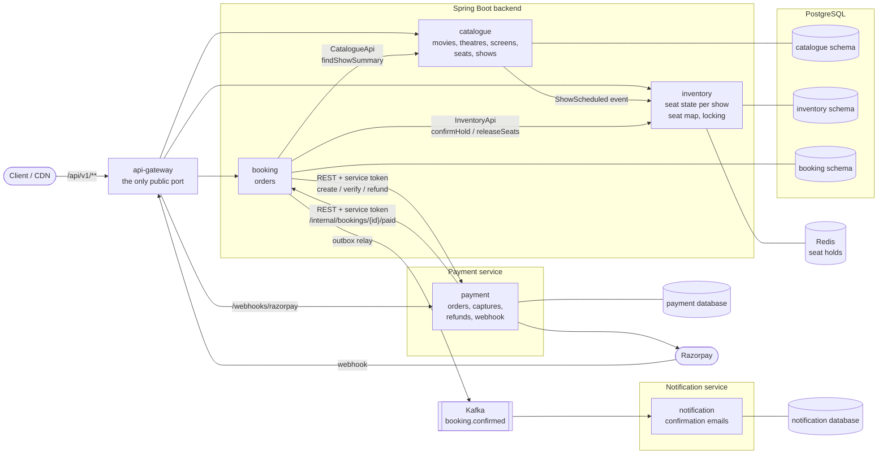
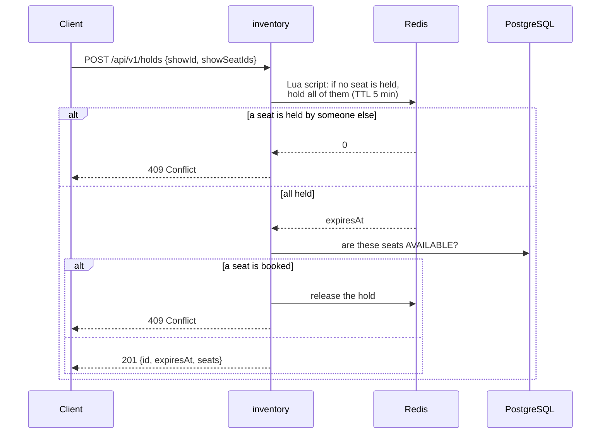
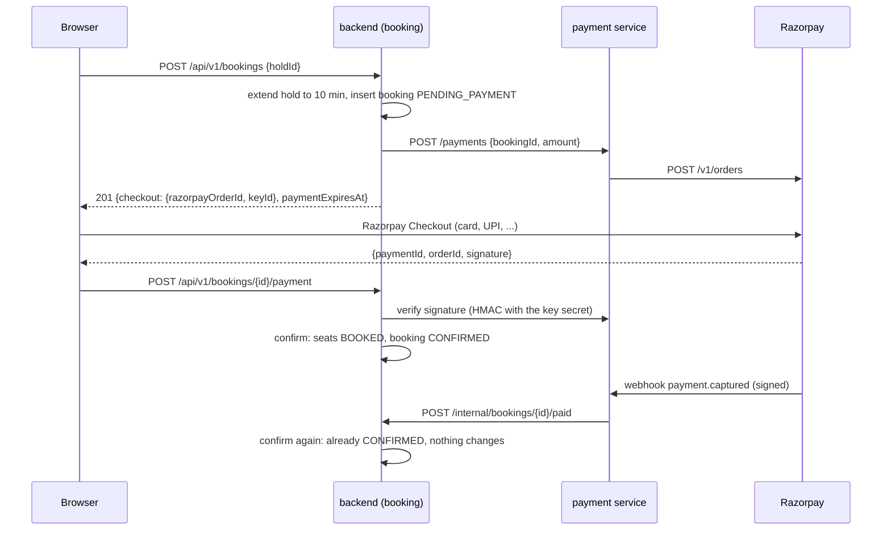
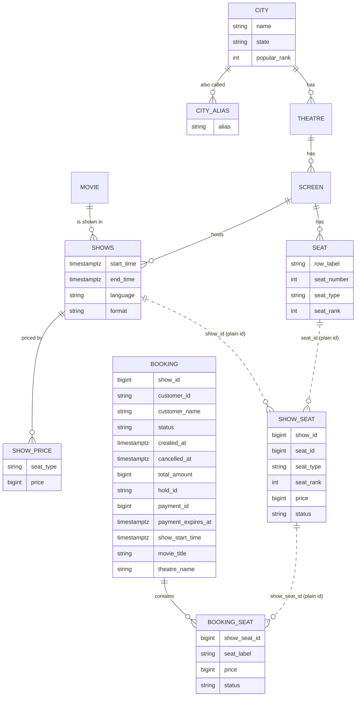

# SeatLock

[](https://github.com/GopiSVDev/seat-lock/actions/workflows/ci.yml)

A movie ticket booking backend (in the spirit of BookMyShow or Ticketmaster) built to answer one question:
**how do you never sell the same seat twice when thousands of people try to book at once?**

It is a modular monolith (Spring Boot 4, Java 25, PostgreSQL 16) plus a separate payment service that takes
real payments through Razorpay (test mode). It started deliberately simple; each
improvement was made only after a load test showed a real problem; the story is in
[loadtest/results/SUMMARY.md](loadtest/results/SUMMARY.md), every run in
[loadtest/results/RESULTS.md](loadtest/results/RESULTS.md).

- [What it does](#what-it-does)
- [Quick start](#quick-start)
- [Architecture](#architecture)
- [How a booking works](#how-a-booking-works)
- [Data model](#data-model)
- [Performance](#performance)
- [Tests](#tests)
- [Project layout](#project-layout)
- [Not built yet](#not-built-yet)

New here? **[docs/story.md](docs/story.md)** explains the whole app as a story about a cinema, no
programming needed. API reference with request and response examples: **[docs/api.md](docs/api.md)**.

## What it does

1. An admin adds **movies**, **theatres** and **screens** (a screen is a seat layout: rows of seats, each
   row REGULAR, PREMIUM or RECLINER). Every theatre is in a **city** picked from a fixed list; city search
   forgives typos and old names ("chenai", "Madras" → Chennai).
2. The admin schedules a **show**: a movie on a screen at a time. Every seat of the screen becomes a
   bookable **show seat** for that show.
3. A customer opens the **seat map** of a show: the layout (which never changes) plus availability (which
   seats are taken right now).
4. The customer **holds** seats for 5 minutes, either the exact seats they picked on the map or "best
   available N seats of a type", where the server chooses the best adjacent block for them. Nobody else
   can take held seats; a hold that isn't booked expires by itself. Holding is rate limited per user, so a
   script can't keep grabbing and releasing seats.
5. The customer **checks out**: the hold is kept for 10 more minutes and they **pay** with Razorpay. Only a
   verified payment books the seats. If the money arrives but the seats were lost in the meantime, the
   payment is refunded automatically; unpaid bookings expire.

28 public endpoints under `/api/v1` plus one internal one, all JSON over HTTP. Errors use the standard
[RFC 9457 problem details](https://www.rfc-editor.org/rfc/rfc9457) format.

| Area | Endpoints |
|---|---|
| Catalogue | `GET /api/v1/cities`, `GET /api/v1/cities/{id}`, `POST /api/v1/cities`, `POST /api/v1/cities/{id}/aliases`, `GET /api/v1/movies`, `POST /api/v1/movies`, `GET /api/v1/movies/{id}`, `GET /api/v1/theatres`, `POST /api/v1/theatres`, `GET /api/v1/theatres/{id}`, `GET /api/v1/theatres/{id}/shows`, `POST /api/v1/theatres/{id}/screens`, `GET /api/v1/screens/{id}`, `GET /api/v1/shows`, `POST /api/v1/shows`, `GET /api/v1/shows/{id}` |
| Seat map | `GET /api/v1/shows/{id}/layout`, `GET /api/v1/shows/{id}/availability` |
| Holds | `POST /api/v1/holds`, `POST /api/v1/holds/best-available`, `GET /api/v1/holds/{id}`, `DELETE /api/v1/holds/{id}` |
| Booking | `POST /api/v1/bookings` (checkout), `POST /api/v1/bookings/{id}/payment`, `GET /api/v1/bookings`, `GET /api/v1/bookings/{id}`, `POST /api/v1/bookings/{id}/cancel` |
| Internal (payment service only) | `POST /internal/bookings/{id}/paid` |

Who may call what: `GET` on catalogue and seat maps is public, creating catalogue data needs the `ADMIN`
role, and holds and bookings need a logged-in user. Logins come from **Keycloak**; the backend checks the JWT access
token on every request (details in [docs/api.md](docs/api.md#authentication)). Every booking belongs to the
user who made it (the token's `sub`); users list and open only their own bookings, and anyone else's booking
answers `404`.

## Quick start

Everything runs in Docker.

```bash
cp .env.example .env            # credentials, ports, Keycloak token settings, thread and pool sizes (no defaults in the app)
docker compose up --build -d    # API gateway :8080 (the only app port), Keycloak :8180, PostgreSQL :5433
docker compose ps               # every service healthy
```

`docker compose up --build -d` starts everything (Postgres, Redis, Keycloak, backend, payment service, API
gateway) in dependency order. Every request goes through the gateway on port 8080. On a new Postgres volume init scripts create the payment and notification databases; on a new
Keycloak volume the realm is imported. After pulling changes to either (new realm clients, a new database),
start over from empty volumes, which **deletes all data** (bookings, shows, Keycloak users created later):

```bash
docker compose down && docker volume rm -f seat-lock_postgres_data seat-lock_keycloak_data && docker compose up --build -d
```

Then walk through the whole flow (ids assume an empty database). Tokens come from Keycloak's dev-only
password login (`jq` extracts them) and last 1 hour (browser logins: 5 minutes): run the two `token` lines
again when calls start returning 401.

```bash
B=localhost:8080/api/v1
token() { curl -s localhost:8180/realms/seatlock/protocol/openid-connect/token -d grant_type=password \
  -d client_id=seatlock-dev-cli -d username=$1 -d password=$1 | jq -r .access_token; }
ADMIN="Authorization: Bearer $(token admin)"
ASHA="Authorization: Bearer $(token asha)"

curl -s -XPOST $B/movies -H "$ADMIN" -H 'Content-Type: application/json' \
  -d '{"title":"Interstellar","durationMinutes":169,"certification":"UA","releaseDate":"2014-11-07",
       "posterUrl":"https://cdn.example.com/posters/interstellar.jpg","genres":["SCI_FI","DRAMA"]}'
curl -s "$B/cities?query=chenai"   # typo tolerant: Chennai, id 5
curl -s -XPOST $B/theatres -H "$ADMIN" -H 'Content-Type: application/json' \
  -d '{"name":"PVR Grand","cityId":5,"address":"1 Main Road"}'
curl -s -XPOST $B/theatres/1/screens -H "$ADMIN" -H 'Content-Type: application/json' \
  -d '{"name":"Screen 1","rows":[{"label":"A","seatCount":10,"seatType":"REGULAR"},
                                 {"label":"B","seatCount":10,"seatType":"REGULAR"},
                                 {"label":"C","seatCount":8,"seatType":"RECLINER"}]}'
curl -s -XPOST $B/shows -H "$ADMIN" -H 'Content-Type: application/json' \
  -d '{"movieId":1,"screenId":1,"startTime":"2030-01-01T13:30:00Z","language":"ENGLISH","format":"IMAX_2D",
       "prices":{"REGULAR":15000,"RECLINER":40000}}'   # 7:00 PM in India; prices in paise (₹150, ₹400)

curl -s $B/shows/1/layout          # rows and seat ids
curl -s $B/shows/1/availability    # which seat ids are taken

HOLD=$(curl -s -XPOST $B/holds -H "$ASHA" -H 'Content-Type: application/json' \
  -d '{"showId":1,"showSeatIds":[1,2]}' | jq -r .id)     # A1, A2 held for 5 minutes (totalAmount 30000 = ₹300)
curl -s -XPOST $B/holds/best-available -H "$ASHA" -H 'Content-Type: application/json' \
  -d '{"showId":1,"quantity":2,"seatType":"RECLINER"}'   # the server picks 2 adjacent recliners
echo "$HOLD"; echo "${ASHA#Authorization: Bearer }"     # paste both into localhost:8080/dev/checkout.html, pay
curl -s -H "$ASHA" $B/bookings/1   # CONFIRMED once paid
curl -s -XPOST -H "$ASHA" $B/bookings/1/cancel   # seats A1, A2 go back on sale
curl -s -H "$ASHA" $B/bookings     # Asha's upcoming bookings, soonest first (?period=PAST for past)
curl -s "$B/movies?cityId=5"       # now showing in Chennai
curl -s "$B/shows?movieId=1&cityId=5&date=2030-01-01"   # its shows that day, by theatre
curl -s "$B/theatres?cityId=5&query=pvr"                 # cinemas in Chennai
curl -s "$B/theatres/1/shows?date=2030-01-01"            # what's playing at one cinema, by movie
```

Paying needs a browser: Razorpay Checkout is a widget, so `/dev/checkout.html` (a dev-only page served by the
backend) calls `POST /api/v1/bookings`, opens Checkout in test mode and sends the result to `/api/v1/bookings/{id}/payment`.
`curl -XPOST $B/bookings -d '{"holdId":...}'` alone gives a `PENDING_PAYMENT` booking that expires unpaid.
The payment service needs Razorpay test keys in `.env` (see [Payments](#paying-checkout-razorpay-and-the-webhook)).

Holding seats someone else holds or booked returns `409 Conflict`; more than 10 holds in a burst (then 1 every 6 s)
returns `429 Too Many Requests` with `Retry-After`. Without a token, `POST /api/v1/movies` returns `401`; with
Asha's token (CUSTOMER) it returns `403`.

Logins are handled by **Keycloak** (admin console at [localhost:8180/admin](http://localhost:8180/admin),
credentials from `.env`). The `seatlock` realm comes with test users `admin`/`admin` (ADMIN), `asha`/`asha`
and `ravi`/`ravi` (CUSTOMER); new sign-ups get CUSTOMER. These are local development credentials only.

**Bruno collection:** [collections/seatlock.bruno.json](collections/seatlock.bruno.json) holds every request above and
more (77, in 8 folders: log in, API docs, cities, admin setup, browsing, seat map, holds/checkout/payment,
security checks that must fail, including paths the gateway must not route), each with tests. Import it in [Bruno](https://www.usebruno.com/), pick the
`local` environment and set its secret `webhookSecret` to your `RAZORPAY_WEBHOOK_SECRET`, run "01 Log in",
then run the collection; created ids are passed along automatically. Bookings are paid with a **simulated
Razorpay webhook**: a script builds a `payment.captured` event and signs it with that secret, so the real
chain runs (signature check, payment service, service token, internal callback). Cancelling such a booking
asks Razorpay to refund a payment it never saw; Razorpay refuses and the backend logs it.

API docs: Swagger UI at [localhost:8080/swagger-ui.html](http://localhost:8080/swagger-ui.html), the OpenAPI
spec at `/v3/api-docs`. Its **Authorize** button logs in through Keycloak (client `seatlock-web`,
authorization code with PKCE) and sends the token with every call. The hand-written reference with examples is [docs/api.md](docs/api.md).

## Architecture

One Spring Boot application (the backend) split into three modules, plus a separate **payment service**,
both behind an **API gateway**, and a **notification service** that only listens to Kafka.
Each backend module owns its own tables in its own PostgreSQL schema, and modules only talk through small
public interfaces or events, so they could later be split into separate services. Redis holds the
short-lived seat holds. Payment was split out first: it holds the payment provider's secrets, talks to an
outside system that can be slow or down, and keeps its own database.



| Module | Owns | Public API (what other modules may use) | Endpoints |
|---|---|---|---|
| **catalogue** | movies, theatres, screens, physical seats, shows | `CatalogueApi`, `ShowSummary`, `ShowScheduled` event | movies, theatres, screens, shows |
| **inventory** | `show_seat`: every seat of every show and its status (AVAILABLE / BOOKED); seat holds (Redis) | `InventoryApi`, `ConfirmedHold`, `BookedSeat` | seat map (layout, availability), holds |
| **booking** | bookings and the seats in each booking; the outbox | `BookingConfirmed` event on Kafka | bookings, internal paid callback |
| **payment** (own app) | payments, payment attempts, refunds (own database `payment`) | REST, service tokens only | `/payments/**`, `/webhooks/razorpay` |
| **notification** (own app) | sent notifications (own database `notification`) | none: consumes `booking.confirmed` | none |
| **api-gateway** (own app) | nothing: routes requests | none | everything public, forwarded |

### The API gateway

`api-gateway` (Spring Cloud Gateway, Server Web MVC) is the **only published port** besides Keycloak's login
pages. The backend and the payment service listen inside Docker only, so the gateway decides what the world
can reach:

| Path | Goes to |
|---|---|
| `/api/v1/**` | backend: the whole public API |
| `/swagger-ui.html`, `/swagger-ui/**`, `/v3/api-docs/**`, `/dev/**` | backend: API docs and the dev checkout page |
| `POST /webhooks/razorpay` | payment service: Razorpay's webhook, the only public payment endpoint |
| anything else, e.g. `/internal/**`, `/payments/**`, `/actuator/**` | nowhere: `404` |

Paths, headers and bodies are forwarded unchanged (the webhook's signature covers the raw bytes). The
services learn the caller's address from `X-Forwarded-For` and log it. A service that is down is `502`, one
slower than 10 s is `504`, both as problem details. Redirects go back to the browser instead of being
followed. Checking tokens and rate limiting at the edge are not done yet: the services check every token
themselves, and no test has shown a need for edge limits.

**Dependencies point one way inside the backend:** booking → inventory → catalogue, and booking → catalogue.
Nothing depends on booking. Booking and the payment service call each other over HTTP (a dependency cycle,
on purpose for now; events in a later step remove the payment → booking call).

**Package rule.** Each module is a package under `com.seatlock.backend`:

```
catalogue/
├── CatalogueApi.java           ← public: other modules may import these
├── ShowSummary.java
├── ShowScheduled.java
└── internal/                   ← private to the module, split by feature
    ├── city/                   entity, repositories, service, controller of one feature
    │   └── dto/                its request/response records
    ├── movie/
    ├── theatre/
    ├── screen/
    └── show/
```

Inside `internal/`, a module with several features (catalogue) gets one folder per feature, so the files
that change together sit together. Single-feature modules (inventory, booking) are split by layer instead:
`domain/`, `repository/`, `service/`, `web/` (with `dto/`).

Other modules never import anything from another module's `internal` package. They reference each other's
data by plain id only: no JPA relations and no foreign keys across schemas. `ArchitectureTest` (ArchUnit)
fails the build if a class breaks this rule.

**How the modules connect:**
- **Scheduling a show** (`POST /api/v1/shows`): catalogue saves the show and publishes a `ShowScheduled` event with
  the screen's seats. Inventory listens and creates one `show_seat` row per seat, copying row, number,
  type and rank so it can serve the seat map without asking catalogue. The listener runs synchronously in
  the same transaction, so a show never exists without its seats.
- **Checkout** (`POST /api/v1/bookings`): booking calls `InventoryApi.startPayment` to keep the hold alive for the
  payment window, asks `CatalogueApi` for the show's details (one query), then inserts an unpaid booking with
  a copy of the show details. The copy lets "my bookings" render and split into upcoming/past by show time
  without asking catalogue.
- **Confirming a paid booking**: booking calls `InventoryApi.confirmHold` to mark the hold's seats BOOKED,
  in the same transaction that marks the booking CONFIRMED; the hold is deleted from Redis only after the
  commit.
- **Cancelling** (`POST /api/v1/bookings/{id}/cancel`): a guarded update
  `... set status = 'CANCELLED' where id = ? and customer_id = ? and status = 'CONFIRMED' and show_start_time > now`
  decides the winner. Only the request that changed the row releases the seats through `InventoryApi`, in
  the same transaction. This matters: if a double-tapped cancel released the seats twice, the second
  release could free a seat someone else had booked in between, and it would be sold twice.

`shared/` holds cross-cutting code: the global error handler, the exception types that services throw
(`NotFoundException`, `ConflictException`, `TooManyRequestsException`, `DownstreamException` → 502, `ServiceUnavailableException` → 503 with `Retry-After`, ...),
security (user tokens in, the backend's own client-credentials token out), and the Redis-backed
`RateLimiter` that modules apply to their own endpoints (inventory limits holds).

**Service-to-service calls carry their own tokens.** Each service is a confidential Keycloak client
(`seatlock-backend`, `seatlock-payment`) and gets a token with the client credentials grant; Spring caches it
until it expires. The token names one role per service and is minted for one audience: the payment service
accepts only tokens for `seatlock-payment-api` with role `PAYMENTS_CLIENT`, and the backend's `/internal/**`
accepts only role `BOOKING_CALLBACK`. A user's token can't call either, and neither can a stolen token of the
other direction.

## How a booking works

This is the core of the project. Thousands of requests may target the same few seats at the same moment.
Buying has three steps, as on any ticket site: **hold** the seats for 5 minutes, **check out** (the hold is
kept for the 10-minute payment window), then **pay**; only a verified payment books the seats.

### Two stores, two jobs

| | Redis | PostgreSQL |
|---|---|---|
| Holds | seat holds with a 5-minute timer | nothing |
| Sold seats | nothing | `show_seat.status`: AVAILABLE or BOOKED |
| If it loses data | a buyer loses their hold and picks again | not acceptable: the source of truth |

Expiry needs no cleanup job: every hold key has a TTL and Redis deletes it. The seat map shows a seat as
taken if Postgres says BOOKED or Redis holds it.

### Holding seats: `POST /api/v1/holds`



- **All or nothing.** The Lua script runs inside Redis as one atomic step: either every seat gets a key
  `seat:{show}:{seat}` with the hold id, or none does. Two buyers can never each get half of a row.
- **Hold first, then check Postgres.** Booking deletes a hold's keys only *after* BOOKED is committed. So if
  a new hold got the keys, any earlier booking of those seats is already visible to the check that follows.
  Checking first would leave a gap where a seat is booked between the check and the hold.
- **One hold per user per show.** A new hold replaces the previous one (the script frees its seats), as when
  a buyer goes back and picks other seats.
- **Rate limited per user.** Holding costs a Redis script and a Postgres read, and without a limit one
  account's script could hold and release hundreds of times a second, competing with real buyers for every
  freed seat. Both hold endpoints share a **token bucket** per user (Bucket4j): 10 tokens, refilled at 10 per
  minute, so a buyer changing seats a few times never notices and a script gets one hold every 6 s; beyond
  that `429` with `Retry-After`. Keyed by the user id from the JWT, not the IP: mobile carriers put thousands
  of phones behind one IP. The buckets live in Redis (compare-and-swap updates), so with several backend
  instances a user still gets 10, not 10 per instance. If Redis is down the limit is skipped (fails open): it
  protects capacity, it never decides who gets a seat. Not covered: many accounts (bot detection).

### Paying: checkout, Razorpay and the webhook



- **Seats are booked only after the money is verified.** The hold keeps them for the buyer while they pay;
  checkout extends it once to 10 minutes (a repeated checkout finds the same booking and does not extend it
  again). Booking first and charging second would leave unpaid seats BOOKED whenever a buyer walks away.
- **No transaction waits on another service.** The booking is inserted, then the payment service is called
  outside any transaction; a database connection is never held while Razorpay answers.
- **Two paths, one confirm.** The browser reports the payment for an instant result; Razorpay's webhook
  reports it too, even if the buyer closed the tab. Both end in the same guarded update
  (`... set status = 'CONFIRMED' where id = ? and status in ('PENDING_PAYMENT', 'EXPIRED')`), so whichever
  comes second changes nothing. If the backend is down when the webhook arrives, the payment service answers
  5xx and Razorpay delivers it again later.
- **Signatures, not trust.** The browser's result is checked with an HMAC of `order_id|payment_id` and the
  webhook with an HMAC of the raw body, both with secrets only Razorpay and the payment service know. A forged
  "paid" from a client or the internet is a 400.
- **Paid, but the seats are gone** (the hold expired, or the buyer started a new hold meanwhile): the booking
  becomes `FAILED` and the payment service refunds the money. A cancel of a paid booking refunds it too.
- **Unpaid bookings expire.** A job runs every 30 s:
  `update booking set status = 'EXPIRED' where status = 'PENDING_PAYMENT' and payment_expires_at < now()`
  (a partial index keeps it to pending rows). It runs on every instance; the guarded update expires each row
  once. Holds need no job: Redis expires them.
- **Idempotent everywhere.** One booking per hold (`uk_booking_hold`), one payment per booking
  (`booking_id` unique in the payment database, so a retry gets the same Razorpay order), one refund per
  payment, and webhook handlers that can run twice.

Booking states: `PENDING_PAYMENT → CONFIRMED → CANCELLED`, `PENDING_PAYMENT → EXPIRED` (unpaid),
`PENDING_PAYMENT/EXPIRED → FAILED` (paid but seats lost, refunded). Payment states (payment service):
`CREATED → CAPTURED → REFUND_PENDING → REFUNDED`; failed card attempts are recorded but keep the order open.

**Known gap (not built):** if the money is captured but both the browser and every webhook delivery are
lost, or a refund request itself fails, nothing retries. A reconciliation job comparing our payments with
Razorpay's would close it.

**Refunds take days.** Razorpay sends `refund.created` within seconds (logged and ignored: the refund id is
already known from the refund request) but `refund.processed` only once the bank has credited the money,
which takes days for a normal-speed refund. Until then the payment stays `REFUND_PENDING`, which is the true
state. `refund.failed` is not handled yet (the payment would stay `REFUND_PENDING`); reconciliation covers it.

**Running it with Razorpay test mode:** put the test Key ID and Key Secret in `.env`
(`RAZORPAY_KEY_ID`, `RAZORPAY_KEY_SECRET`) plus a webhook secret of your own (`RAZORPAY_WEBHOOK_SECRET`).
Razorpay's webhook needs a public HTTPS URL; a Cloudflare quick tunnel to the payment service gives one
for local runs (no Cloudflare account needed):

```bash
docker compose --profile tunnel up -d tunnel
docker compose logs tunnel | grep -o 'https://[a-z0-9-]*\.trycloudflare\.com'
```

The URL changes every time the tunnel starts, so after each start update the webhook in the Razorpay dashboard
(test mode, Settings → Webhooks): URL = tunnel URL + `/webhooks/razorpay`, secret = `RAZORPAY_WEBHOOK_SECRET`,
events `payment.captured`, `payment.failed` and `refund.processed`. Without the tunnel everything still works
through the browser path; only the webhook backup is missing.

To see whether Razorpay's webhooks arrive: `docker compose logs -f payment | grep -E 'webhooks|Razorpay event'`.
Each delivery logs its event and ids, then `POST /webhooks/razorpay -> 200`; a wrong secret shows as
`Rejected Razorpay webhook: invalid signature` and `-> 400`.

### When the payment service is slow or down

Every checkout waits on the payment service, and each waiting request holds one of the backend's request
threads. Without protection a slow payment service would hold all of them, and even the seat map would stop
answering (`PaymentResilienceTest` proved this before the fix). Three Resilience4j guards in `PaymentClient`:

- **Timeouts shrink inwards:** gateway 10 s → backend waits 7 s for the payment service → it waits 5 s for
  Razorpay. The inner call always gives up first, so its error reaches the caller instead of a gateway 504
  while the work goes on behind it.
- **Bulkhead:** at most `PAYMENT_MAX_CONCURRENT_CALLS` (50 of 200 threads) checkout and pay calls at once,
  and none queue. The next one gets `503 Payments are busy, try again in 5 seconds` with `Retry-After: 5`
  at once, so the other threads stay free for browsing and holds.
- **Circuit breaker:** over the last 10 calls (judged from 5), if half failed or took over 3 s, the backend
  stops calling for 30 s and answers `503 Payments are unavailable, try again in N seconds` without
  waiting. Then 2 trial calls decide: both fine closes it, a failure opens it again. Timeouts, connection
  errors and 5xx count as failures; a `4xx` (say, a forged signature) is a bad request, not a sick service,
  so it doesn't. Refunds go through the breaker but not the bulkhead: they are rare, and turning one away
  because checkouts are busy would leave the money stuck.

The breaker's state changes are logged (`Payment circuit breaker OPEN ...`) and exported to Prometheus
(`resilience4j_circuitbreaker_state`, `resilience4j_bulkhead_available_concurrent_calls`, ...). Cancel
calls the refund only after its transaction has returned the database connection, so a slow refund can't
drain the 10-connection pool.

### Confirming a paid booking

1. A Lua script checks the hold belongs to the buyer and keeps its keys alive for at least 60 more
   seconds, so the hold can't expire and be grabbed while the booking is being confirmed.
2. In one transaction: the booking's guarded update to CONFIRMED, then the same guarded seat update as always,
   `UPDATE show_seat SET status = 'BOOKED' WHERE id IN (...) AND status = 'AVAILABLE' RETURNING id, label`.
3. After the commit, the hold's keys are deleted.

**Why a seat is still never sold twice, even if Redis fails.** The guard `AND status = 'AVAILABLE'` decides,
not Redis. PostgreSQL locks each row it updates, so of two requests racing for seat A5 the second waits,
re-checks, finds it BOOKED and updates nothing; fewer rows than seats means 409 and a rollback. If Redis
restarted and forgot every hold, the worst case is an annoyed buyer, never a double sale. If Redis is down,
holding answers `503` (fails closed).

**Safety net:** a partial unique index (in the `V1__baseline.sql` migration) allows at most one
CONFIRMED booking per show seat. If the application logic ever had a bug, the database would still refuse a
double sale.

### Telling other services: the outbox and Kafka

When a booking is confirmed, the notification service sends the customer a confirmation. Calling it over
HTTP would make confirming depend on it (the problem from the previous section), and sending a message
after the commit loses it if the backend dies in between; sending before the commit announces a booking
that may roll back. The database and Kafka can't be updated in one atomic step (the dual-write problem), so:

1. **Transactional outbox.** The `BookingConfirmed` event is inserted into `booking.outbox` in the same
   transaction that sets the booking `CONFIRMED`: both commit or neither does.
2. **Relay.** A job in the backend runs every 500 ms, takes unsent rows (`FOR UPDATE SKIP LOCKED`, so with
   two instances each row goes out once), sends them to Kafka topic `booking.confirmed` (key = booking id,
   so one booking's events stay in order) and marks them sent. If Kafka is down the rows wait; confirming
   never waits on Kafka.
3. **At least once.** A crash after sending but before marking sends the row again. The notification
   service stores each `eventId` under a unique constraint first (`ON CONFLICT DO NOTHING`), so a repeat
   is skipped and the customer gets one email.

The "email" is a log line: `docker compose logs -f notification`. In production, change data capture
(Debezium reading the outbox table from Postgres's log) often replaces the polling relay.

### Best available: `POST /api/v1/holds/best-available`

During a flash sale most buyers want "2 good seats together" and all aim at the same centre seats, so
exact-seat requests collide and most get 409. Best available lets the server choose instead:

1. Every seat has a **rank** computed when the screen is created: 1 is the best seat, nearest the sweet
   spot (60% of the way back, centre of the row; one row away counts like two seats along the row).
2. Inventory reads the available seats of the requested type by rank (no row locks) and drops the ones
   held in Redis.
3. In Java it finds the best block of N seats next to each other in one row (lowest total rank).
4. It holds the block with the same Lua script. If another buyer held one of those seats a moment earlier,
   it picks again, up to 3 times.
5. If no block of N adjacent seats is left: `409 No N adjacent <type> seats available`.

(Before holds this step locked candidate rows with `SELECT ... FOR UPDATE SKIP LOCKED`; Redis now decides
who gets a seat, so the hot path takes no row locks until the booking itself.)

### The seat map: built for many readers

Viewing the map is far more frequent than booking, so it is split in two:

| | `GET /api/v1/shows/{id}/layout` | `GET /api/v1/shows/{id}/availability` |
|---|---|---|
| Content | rows, seat ids, numbers, types, prices | count of free seats + ids of taken seats |
| Changes | never (for a show) | on every hold and booking |
| Caching | `Cache-Control: public, max-age=86400, immutable`: browsers and CDNs keep it; in-app cache too | in-app cache for 1 second |
| Size | ~6 KB for 250 seats | ~50 bytes to ~2 KB |

Availability can be up to 1 second stale. That is safe: a hold always re-checks every seat, so a stale map
can only cause a 409, never a double sale. Both responses are cached as
ready-made JSON bytes (Caffeine), so a cache hit skips the database and JSON serialization entirely.

## Data model



Solid lines are real foreign keys inside a schema; dotted lines are plain ids across modules.

- **Seat vs show seat.** `seat` (catalogue) is the physical chair. `show_seat` (inventory) is that chair for
  one show; a 250-seat screen gives 250 show seats per show. Booking changes AVAILABLE → BOOKED.
- **Booking vs booking seat.** Like an order and its order lines: one row per seat, so history survives a
  cancellation and re-sale of the same seat. A partial unique index allows only one CONFIRMED booking seat
  per show seat; pending, expired, failed and cancelled rows drop out of it, so the seat can be sold again.
- **Payments live in another database.** `booking.payment_id` is a plain id of the payment service's
  `payment` table (database `payment`, its own user; tables `payment`, `payment_attempt`, `refund`). No
  foreign key and no transaction spans the two.
- **Cities are reference data.** The list (45 Indian cities, 10 marked popular, plus aliases like Madras,
  Bangalore, Gurgaon) is loaded by a migration; theatres point to a city by id, so a misspelt city can't get
  in. Search matches names and aliases by prefix and by trigram similarity (`pg_trgm`), so typos still
  find the right city.
- **Prices.** Set per seat type when a show is created (`show_price`) and fixed after that. Show seats copy
  their price like row and type, so inventory prices a hold alone; booking seats copy it again, so a
  booking keeps what was paid. Money is integer paise (`15000` = ₹150): no rounding, and it is the unit
  payment providers use.
- Times are stored as UTC `timestamptz`. Enums are stored as text.
- The schema is owned by **Flyway**: versioned SQL files in `backend/src/main/resources/db/migration`, applied
  at startup and recorded in `flyway.flyway_schema_history`. Hibernate only validates that the entities match
  (`ddl-auto=validate`); a change to the schema is a new migration file, never an edit of an applied one.

## Performance

Measured on a deliberately small box: an LXD VM with **1 vCPU and 2 GB RAM**, load generated by k6 from the
host. Every step, what it changed and what it gained, plus the experiments that were measured and rejected,
is in [loadtest/results/SUMMARY.md](loadtest/results/SUMMARY.md); every individual run, with its pass
criteria and a detailed report, is in [loadtest/results/RESULTS.md](loadtest/results/RESULTS.md).

| Test | First version | Now | Main changes |
|---|---:|---:|---|
| Seat map views | 710 /s | 4,150 /s | projections instead of entities, layout/availability split, CDN-cacheable layout, 1 s cache of serialized JSON, host networking |
| Bookings | 470 /s | 960 /s | single-statement guarded UPDATE with RETURNING, booking + seats inserted in one statement, tuned thread and connection pool sizes |
| Flash sale (200 users/s on a 1,000-seat show) | failed | sold out in 10.1 s, 0 oversold | faster seat map and booking, then best-available booking with `SKIP LOCKED`: booking attempts −75%, buyers giving up −90%, no failed attempts while seats remained |

Oversold seats in every test so far: **0**. These runs predate seat holds (step 3): booking was then one request, now it is a hold plus a booking.

## Tests

```bash
docker compose run --rm backend-test    # Maven in Docker; Testcontainers starts a throwaway PostgreSQL 16 and Redis 8
docker compose run --rm payment-test    # the payment service's own tests (PostgreSQL + WireMock as Razorpay)
docker compose run --rm api-gateway-test   # the gateway's routes (WireMock plays the backend and the payment service)
docker compose run --rm notification-test  # the notification service (PostgreSQL + Kafka)
```

**CI** ([.github/workflows/ci.yml](.github/workflows/ci.yml)) runs on every pull request and push to `main`: one
parallel job per app runs `mvn spotless:check verify` (formatting, then every test, with Testcontainers on the
runner's Docker), writes the line coverage (JaCoCo) to the run summary, uploads the coverage report, and checks
that the Docker image still builds. No secrets are needed: Razorpay, Keycloak and the other services are faked in tests.

Tests run against a **real PostgreSQL** with every Flyway migration applied and a **real Redis**, and talk to the app over **real
HTTP** on a random port, so security filters, error handling, JSON and SQL are all part of each test. Each test
creates its own city, theatre, show and users, so tests are independent of each other and of their order.
Logins don't need Keycloak: a test-only `JwtDecoder` turns test tokens into JWTs, while the real role mapping
and ownership checks run unchanged (the real Keycloak path is covered by the Bruno collection). Other
services are **WireMock**: in backend tests it plays the payment service and Keycloak's token endpoint (every
payment succeeds unless a test says otherwise); in payment tests it plays Razorpay, Keycloak and the backend.

| Test | What it proves |
|---|---|
| `BookingConcurrencyTest` | 20 buyers racing for the same seats: exactly 1 wins, also with seat ids in opposite orders; 30 parallel best-available buyers never share a seat and all can book; a double-tapped checkout and pay books once; 10 simultaneous cancels release the seats once |
| `BookingPaymentTest` | checkout extends the hold to the payment window without booking seats and calls the payment service with a service token; a repeated checkout finds the same booking; payment service down → 502, then a retry works; a verified payment books the seats; a rejected signature leaves the booking unpaid; the webhook callback confirms once; `/internal/**` refuses users, admins and other services; browser and webhook racing confirm once; paid after the hold was lost → FAILED + one refund; unpaid bookings expire and stay out of my bookings; cancelling a paid booking refunds it; the logs say who confirmed a payment (browser or webhook) |
| `BookingApiTest` | owner taken from the token, show copy on the booking, a booked hold is gone from Redis, 409 for taken seats, only the holder can book a hold, others' bookings are 404, upcoming/past split, cancel, idempotent cancel, no cancel after the show started |
| `HoldRateLimitTest` | the 11th hold in a burst is 429 with `Retry-After` and problem details, the bucket lives in Redis with an expiry, both hold endpoints share it, other users keep their own bucket, release and booking aren't limited |
| `HoldApiTest` | a hold lasts 5 minutes (TTL set in Redis), held seats are 409 for others and unavailable on the seat map, release, expiry frees the seats and the expired hold can't be booked, a new hold replaces the old one, others' holds are 404, booked seats can't be held, best-available blocks skip held seats, validation |
| `BookingConstraintsTest` | the database itself refuses bad states: a cancelled booking without a time, an unpaid booking without a deadline, unknown statuses, one seat in two confirmed bookings |
| `PaymentApiTest` (payment) | one Razorpay order per booking, a different amount is 409, Razorpay down → 502 and nothing saved, only the `PAYMENTS_CLIENT` role gets in, a valid Checkout signature captures, forged signatures (or another order's) are 400, a refund is asked once, an unpaid payment can't be refunded, a refused refund can be asked again |
| `WebhookTest` (payment) | unsigned or forged events are 400; `payment.captured` captures and calls the backend with a service token; repeats change nothing; backend down → 502 so Razorpay retries; a failed attempt keeps the order open; `refund.processed` completes the refund; unknown orders and other events are acknowledged; the payment method survives the browser reporting first; every event is logged with its ids, a forged one with a warning |
| `SecurityRulesTest` | public reads (and the dev checkout page), 401 with problem details and `WWW-Authenticate`, invalid tokens, 403 for customers on admin endpoints, unknown paths closed by default, the API only under `/api/v1` and the internal endpoint outside it |
| `RequestLogTest` | every request logs the caller's address, method, path, status and time (the address from the gateway's `X-Forwarded-For`), rejections log their reason; health checks are not logged |
| `RoutingTest` (api-gateway) | API calls reach the backend with path, query, token and body unchanged and answers come back as they are; the tooling pages too, with redirects passed back; the webhook reaches the payment service byte for byte; `/internal`, `/payments`, `/actuator` and unknown paths are 404 and never forwarded; forwarded headers; a service that is down is 502, a slow one 504 |
| `CatalogueApiTest`, `SeatMapApiTest` | typo-tolerant city search, validation errors per field, a new show appears in now showing, showtimes and the theatre page; seat map layout and availability |
| `ArchitectureTest` (ArchUnit) | module boundaries: no module uses another's `internal` package, catalogue depends on no other module, nothing depends on booking |
| `BookingEventsTest` | a confirmed booking writes one outbox row and its `BookingConfirmed` event reaches Kafka, even when browser and webhook both report the payment; with Kafka paused, confirming still answers at once and the event follows once Kafka is back |
| `BookingConfirmedListenerTest` (notification) | an event sends one email with the booking's details; the same event delivered twice sends one |
| `PaymentResilienceTest` | with the payment service taking 5 s, 22 parallel checkouts leave the seat map answering in under 1 s: 10 wait, 12 get `503` + `Retry-After` at once; 5 failures open the breaker, the next checkout is `503` without calling the payment service, and it closes again once the service is back; rejected signatures (400) never open it; a slow refund holds no database connection |
| `CurrentUserTest`, `IndiaTimeTest`, `GlobalExceptionHandlerTest`, `RateLimiterTest` | unit tests: name fallbacks from the token, the India day boundary, 503 when Redis is unreachable, `Retry-After` rounded up to whole seconds, 503 with `Retry-After` when a dependency is refused, the rate limit lets requests through when Redis fails |

## Project layout

```
backend/              Spring Boot application (Dockerfile, pom.xml, src/)
payment/              payment service, a separate Spring Boot application (Dockerfile, pom.xml, src/)
api-gateway/          API gateway, the single entry point (Dockerfile, pom.xml, src/)
notification/         notification service: consumes booking.confirmed from Kafka (Dockerfile, pom.xml, src/)
keycloak/             Keycloak realm (roles, login and service clients, test users), imported on first start
postgres/             init scripts: the payment and notification databases and their users
docker-compose.yml    postgres + redis + kafka + backend + payment + notification + api-gateway + keycloak; profiles: test, tunnel (Razorpay webhook), monitoring (Prometheus, postgres-exporter), cdn (nginx edge)
docker-compose.vm.yml host networking overrides for the load-test VM
.env.example          every setting the app needs (copy to .env)
loadtest/results/     SUMMARY.md: performance story; RESULTS.md + runs/: every load-test run and its report
monitoring/           Prometheus config, PostgreSQL init (pg_stat_statements)
docs/                 api.md (API reference), story.md (the app explained as a story)
collections/          Bruno collection: every endpoint with tests, importable
```

Configuration comes only from environment variables (see `.env.example`); there are no defaults in the
app, so a missing value fails at startup instead of silently using a wrong one. Metrics are exposed at
`/actuator/prometheus` inside Docker only: the gateway does not route `/actuator`, and its own actuator listens
on port 9000, which is not published.

**Logs** (plain text on stdout, `docker compose logs <service>`), the same in every application:

- one line per request: `172.18.0.1 POST /api/v1/bookings/7/payment -> 200 (85 ms)` (the caller's address); health checks and metric scrapes are skipped
- every rejection with its reason: `Rejected with 409: Show has already started`, `Rejected with 401: Jwt expired at …`
- every state change in the booking flow, with ids: hold placed, kept for payment, confirmed or released;
  booking started, confirmed (and whether the browser or the webhook reported it), failed, cancelled;
  how many unpaid bookings each sweep expired;
  payment created, captured, refund requested, refunded; each Razorpay webhook with its event and ids
- warnings for what needs a look (forged signatures, a paid booking whose seats were lost, a failed refund request)

Never logged: tokens, signatures, secrets, request or response bodies, customer names. Customers appear only
as their opaque Keycloak id. A log level can be changed without a rebuild through the service's environment in
compose, for example `LOGGING_LEVEL_COM_SEATLOCK=DEBUG`. Request ids across services (tracing) are not built.

## Not built yet

Deliberately left out until a test or feature needs them:

- **Kafka extras**: a dead-letter topic (a broken message is retried 10 times, then logged and skipped),
  a schema registry, real email or SMS, change data capture instead of the polling relay.

- **Payment reconciliation**: retrying lost confirmations and failed refund requests;
  partial refunds and cancellation fees.
- **Edge checks at the gateway**: token checks and per-IP rate limits for anonymous reads (the services
  check every token themselves today).
- **Flash-sale protection**: admission control and a waiting room for traffic beyond capacity.
- **Delivery pipeline**: publishing images to a registry (GHCR), static analysis (SonarCloud), image
  vulnerability scans (Trivy), a coverage threshold.
- Search.
- Show overlap checks.
- **Horizontal scaling**: holds and rate limits already live in Redis; the availability cache stays per instance
  (Caffeine) on purpose: sharing it in Redis would turn every ~1 µs hit into a network round trip to save a few
  database queries per second per show. To be measured once there are several instances.
