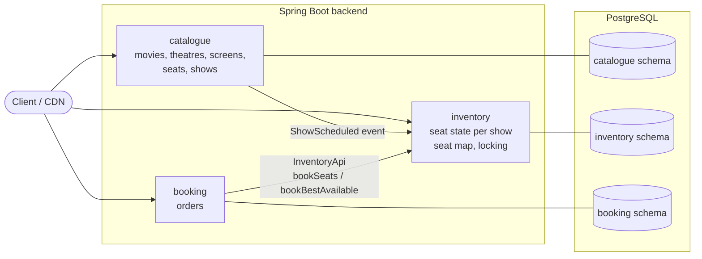
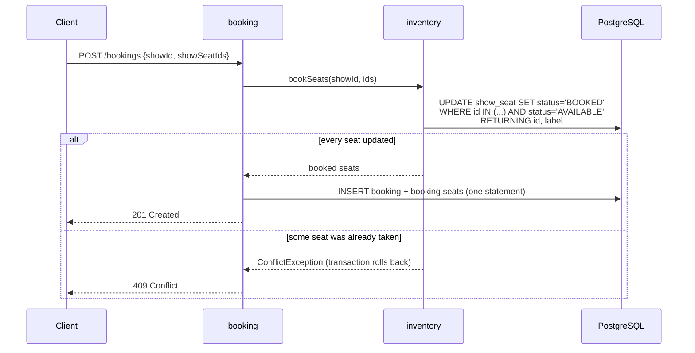
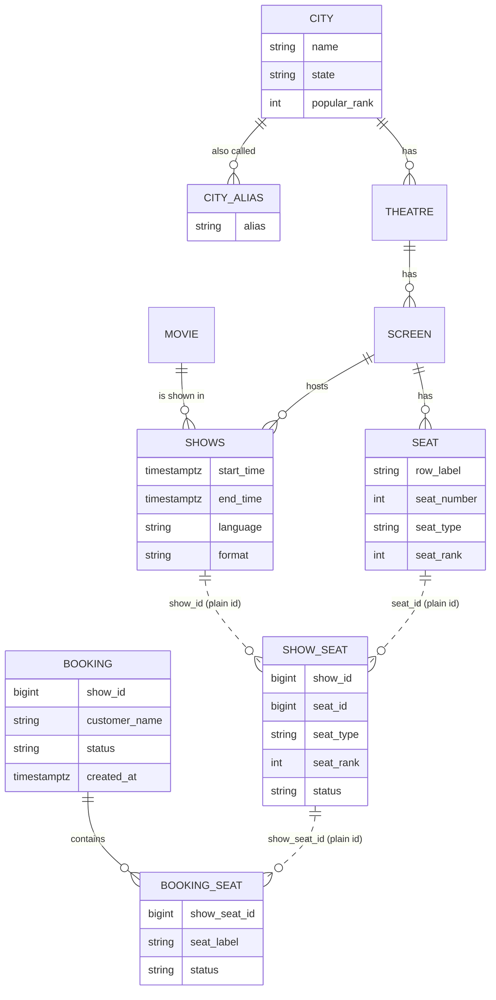

# SeatLock

A movie ticket booking backend (in the spirit of BookMyShow or Ticketmaster) built to answer one question:
**how do you never sell the same seat twice when thousands of people try to book at once?**

It is a modular monolith (Spring Boot 4, Java 25, PostgreSQL 16). It started deliberately simple; each
improvement was made only after a load test showed a real problem; the story is in
[loadtest/results/SUMMARY.md](loadtest/results/SUMMARY.md), every run in
[loadtest/results/RESULTS.md](loadtest/results/RESULTS.md).

- [What it does](#what-it-does)
- [Quick start](#quick-start)
- [Architecture](#architecture)
- [How a booking works](#how-a-booking-works)
- [Data model](#data-model)
- [Performance](#performance)
- [Project layout](#project-layout)
- [Not built yet](#not-built-yet)

New here? **[docs/story.md](docs/story.md)** explains the whole app as a story about a cinema, no
programming needed. API reference with request and response examples: **[docs/api.md](docs/api.md)**.

## What it does

1. An admin adds **movies**, **theatres** and **screens** (a screen is a seat layout: rows of seats, each
   row REGULAR, PREMIUM or RECLINER). Every theatre is in a **city** picked from a fixed list; city search
   forgives typos and old names ("chenai", "Madras" → Chennai).
2. The admin schedules a **show**: a movie on a screen at a time. Every seat of the screen becomes a
   bookable **show seat** for that show.
3. A customer opens the **seat map** of a show: the layout (which never changes) plus availability (which
   seats are taken right now).
4. The customer **books**, either the exact seats they picked on the map or "best available N seats of a
   type", where the server chooses the best adjacent block for them.

21 endpoints in total, all JSON over HTTP. Errors use the standard
[RFC 9457 problem details](https://www.rfc-editor.org/rfc/rfc9457) format.

| Area | Endpoints |
|---|---|
| Catalogue | `GET /cities`, `GET /cities/{id}`, `POST /cities`, `POST /cities/{id}/aliases`, `GET /movies`, `POST /movies`, `GET /movies/{id}`, `GET /theatres`, `POST /theatres`, `GET /theatres/{id}`, `GET /theatres/{id}/shows`, `POST /theatres/{id}/screens`, `GET /screens/{id}`, `GET /shows`, `POST /shows`, `GET /shows/{id}` |
| Seat map | `GET /shows/{id}/layout`, `GET /shows/{id}/availability` |
| Booking | `POST /bookings`, `POST /bookings/best-available`, `GET /bookings/{id}` |

There is no login yet: a booking just carries a `customerName`.

## Quick start

Everything runs in Docker.

```bash
cp .env.example .env            # database credentials, ports, thread and pool sizes (no defaults in the app)
docker compose up --build -d    # PostgreSQL on :5433, backend on :8080, Keycloak on :8180
curl -s localhost:8080/actuator/health
```

Then walk through the whole flow (ids assume an empty database):

```bash
B=localhost:8080
curl -s -XPOST $B/movies -H 'Content-Type: application/json' \
  -d '{"title":"Interstellar","durationMinutes":169,"certification":"UA","releaseDate":"2014-11-07",
       "posterUrl":"https://cdn.example.com/posters/interstellar.jpg","genres":["SCI_FI","DRAMA"]}'
curl -s "$B/cities?query=chenai"   # typo tolerant: Chennai, id 5
curl -s -XPOST $B/theatres -H 'Content-Type: application/json' \
  -d '{"name":"PVR Grand","cityId":5,"address":"1 Main Road"}'
curl -s -XPOST $B/theatres/1/screens -H 'Content-Type: application/json' \
  -d '{"name":"Screen 1","rows":[{"label":"A","seatCount":10,"seatType":"REGULAR"},
                                 {"label":"B","seatCount":10,"seatType":"REGULAR"},
                                 {"label":"C","seatCount":8,"seatType":"RECLINER"}]}'
curl -s -XPOST $B/shows -H 'Content-Type: application/json' \
  -d '{"movieId":1,"screenId":1,"startTime":"2030-01-01T18:30:00Z","language":"ENGLISH","format":"IMAX_2D"}'

curl -s $B/shows/1/layout          # rows and seat ids
curl -s $B/shows/1/availability    # which seat ids are taken

curl -s -XPOST $B/bookings -H 'Content-Type: application/json' \
  -d '{"showId":1,"customerName":"asha","showSeatIds":[1,2]}'
curl -s -XPOST $B/bookings/best-available -H 'Content-Type: application/json' \
  -d '{"showId":1,"customerName":"ravi","quantity":2,"seatType":"RECLINER"}'
curl -s $B/bookings/1
curl -s "$B/movies?cityId=5"       # now showing in Chennai
curl -s "$B/shows?movieId=1&cityId=5&date=2030-01-01"   # its shows that day, by theatre
curl -s "$B/theatres?cityId=5&query=pvr"                 # cinemas in Chennai
curl -s "$B/theatres/1/shows?date=2030-01-01"            # what's playing at one cinema, by movie
```

Booking the same seats twice returns `409 Conflict`.

Logins are handled by **Keycloak** (admin console at [localhost:8180/admin](http://localhost:8180/admin),
credentials from `.env`). The `seatlock` realm comes with test users `admin`/`admin` (ADMIN), `asha`/`asha`
and `ravi`/`ravi` (CUSTOMER); new sign-ups get CUSTOMER. These are local development credentials only.

API docs: Swagger UI at [localhost:8080/swagger-ui.html](http://localhost:8080/swagger-ui.html), the OpenAPI
spec at `/v3/api-docs`; the hand-written reference with examples is [docs/api.md](docs/api.md).

## Architecture

One Spring Boot application split into three modules. Each module owns its own tables in its own
PostgreSQL schema, and modules only talk through small public interfaces or events, so they could later be
split into separate services.



| Module | Owns | Public API (what other modules may use) | Endpoints |
|---|---|---|---|
| **catalogue** | movies, theatres, screens, physical seats, shows | `ShowScheduled` event | movies, theatres, screens, shows |
| **inventory** | `show_seat`: every seat of every show and its status (AVAILABLE / BOOKED) | `InventoryApi`, `BookedSeat` | seat map (layout, availability) |
| **booking** | bookings and the seats in each booking | none yet | bookings |

**Dependencies point one way:** booking → inventory → catalogue. Nothing depends on booking.

**Package rule.** Each module is a package under `com.seatlock.backend`:

```
catalogue/
├── ShowScheduled.java          ← public: other modules may import this
└── internal/                   ← private to the module
    ├── domain/                 JPA entities and enums
    ├── repository/             Spring Data / JDBC access
    ├── service/                business logic, transactions
    └── web/                    controllers and request/response records (dto/)
```

Other modules never import anything from another module's `internal` package. They reference each other's
data by plain id only: no JPA relations and no foreign keys across schemas. The rule is followed by
convention for now; nothing enforces it with a tool yet.

**How the modules connect:**
- **Scheduling a show** (`POST /shows`): catalogue saves the show and publishes a `ShowScheduled` event with
  the screen's seats. Inventory listens and creates one `show_seat` row per seat, copying row, number,
  type and rank so it can serve the seat map without asking catalogue. The listener runs synchronously in
  the same transaction, so a show never exists without its seats.
- **Booking** (`POST /bookings...`): booking calls `InventoryApi` to mark the seats BOOKED, then inserts
  the booking. Both happen in one database transaction, so either both succeed or neither does.

`shared/` holds cross-cutting code: the global error handler and the `NotFoundException` /
`ConflictException` types that services throw.

## How a booking works

This is the core of the project. Thousands of requests may target the same few seats at the same moment.

### Picking exact seats: `POST /bookings`



The guard `AND status = 'AVAILABLE'` is the whole trick. PostgreSQL locks each row it updates, so when two
requests race for seat A5, the second one waits for the first to commit, re-checks the condition, finds
the seat BOOKED, and updates nothing. If fewer rows came back than were requested, the request fails and
everything it touched is rolled back. No seat is ever half-booked.

**Safety net:** a partial unique index (in the `V1__baseline.sql` migration) allows at most one
CONFIRMED booking per show seat. If the application logic ever had a bug, the database would still refuse a
double sale.

### Best available: `POST /bookings/best-available`

During a flash sale most buyers want "2 good seats together" and all aim at the same centre seats, so
exact-seat requests collide and most get 409. Best available lets the server choose instead:

1. Every seat has a **rank** computed when the screen is created: 1 is the best seat, nearest the sweet
   spot (60% of the way back, centre of the row; one row away counts like two seats along the row).
2. Inventory locks the 50 best-ranked available seats of the requested type with
   `SELECT ... FOR UPDATE SKIP LOCKED`. **SKIP LOCKED** means seats another buyer is booking right now are
   skipped, not waited on: concurrent buyers lock different seats instead of fighting over the same ones.
3. In Java it finds the best block of N seats next to each other in one row (lowest total rank). If none
   fits, it locks the next 50 and searches again.
4. It books the block with the same guarded UPDATE as above. Seats it locked but did not book are released
   when the transaction commits.
5. If no block of N adjacent seats is left: `409 No N adjacent <type> seats available`.

### The seat map: built for many readers

Viewing the map is far more frequent than booking, so it is split in two:

| | `GET /shows/{id}/layout` | `GET /shows/{id}/availability` |
|---|---|---|
| Content | rows, seat ids, numbers, types | count of free seats + ids of taken seats |
| Changes | never (for a show) | on every booking |
| Caching | `Cache-Control: public, max-age=86400, immutable`: browsers and CDNs keep it; in-app cache too | in-app cache for 1 second |
| Size | ~6 KB for 250 seats | ~50 bytes to ~2 KB |

Availability can be up to 1 second stale. That is safe: a booking always re-checks every seat in the
database, so a stale map can only cause a 409, never a double sale. Both responses are cached as
ready-made JSON bytes (Caffeine), so a cache hit skips the database and JSON serialization entirely.

## Data model



Solid lines are real foreign keys inside a schema; dotted lines are plain ids across modules.

- **Seat vs show seat.** `seat` (catalogue) is the physical chair. `show_seat` (inventory) is that chair for
  one show; a 250-seat screen gives 250 show seats per show. Booking changes AVAILABLE → BOOKED.
- **Booking vs booking seat.** Like an order and its order lines: one row per seat, so history survives a
  future cancellation and re-sale of the same seat.
- **Cities are reference data.** The list (45 Indian cities, 10 marked popular, plus aliases like Madras,
  Bangalore, Gurgaon) is loaded by a migration; theatres point to a city by id, so a misspelt city can't get
  in. Search matches names and aliases by prefix and by trigram similarity (`pg_trgm`), so typos still
  find the right city.
- Times are stored as UTC `timestamptz`. Enums are stored as text.
- The schema is owned by **Flyway**: versioned SQL files in `backend/src/main/resources/db/migration`, applied
  at startup and recorded in `flyway.flyway_schema_history`. Hibernate only validates that the entities match
  (`ddl-auto=validate`); a change to the schema is a new migration file, never an edit of an applied one.

## Performance

Measured on a deliberately small box: an LXD VM with **1 vCPU and 2 GB RAM**, load generated by k6 from the
host. Every step, what it changed and what it gained, plus the experiments that were measured and rejected,
is in [loadtest/results/SUMMARY.md](loadtest/results/SUMMARY.md); every individual run, with its pass
criteria and a detailed report, is in [loadtest/results/RESULTS.md](loadtest/results/RESULTS.md).

| Test | First version | Now | Main changes |
|---|---:|---:|---|
| Seat map views | 710 /s | 4,150 /s | projections instead of entities, layout/availability split, CDN-cacheable layout, 1 s cache of serialized JSON, host networking |
| Bookings | 470 /s | 960 /s | single-statement guarded UPDATE with RETURNING, booking + seats inserted in one statement, tuned thread and connection pool sizes |
| Flash sale (200 users/s on a 1,000-seat show) | failed | sold out in 10.1 s, 0 oversold | faster seat map and booking, then best-available booking with `SKIP LOCKED`: booking attempts −75%, buyers giving up −90%, no failed attempts while seats remained |

Oversold seats in every test so far: **0**.

## Project layout

```
backend/              Spring Boot application (Dockerfile, pom.xml, src/)
keycloak/             Keycloak realm (roles, login clients, test users), imported on first start
docker-compose.yml    postgres + backend; profiles: monitoring (Prometheus, postgres-exporter), cdn (nginx edge)
docker-compose.vm.yml host networking overrides for the load-test VM
.env.example          every setting the app needs (copy to .env)
loadtest/results/     SUMMARY.md: performance story; RESULTS.md + runs/: every load-test run and its report
monitoring/           Prometheus config, PostgreSQL init (pg_stat_statements)
docs/                 api.md (API reference), story.md (the app explained as a story)
```

Configuration comes only from environment variables (see `.env.example`); there are no defaults in the
app, so a missing value fails at startup instead of silently using a wrong one. Metrics are exposed at
`/actuator/prometheus`.

## Not built yet

Deliberately left out until a test or feature needs them:

- **Seat holds**: reserve seats for a few minutes while the customer pays (today a booking is confirmed
  immediately).
- **Payment**, cancellation, refunds.
- **Flash-sale protection**: admission control and a waiting room for traffic beyond capacity.
- **Login / users**, notifications, search.
- **Automated tests** (Testcontainers), show overlap checks.
- **Horizontal scaling**: several backend instances would need the in-memory caches moved to Redis.
