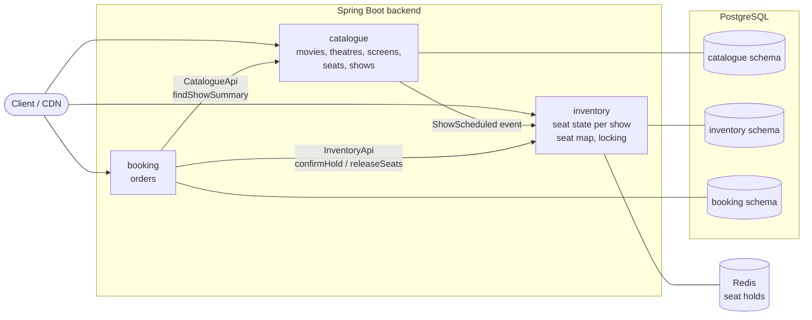
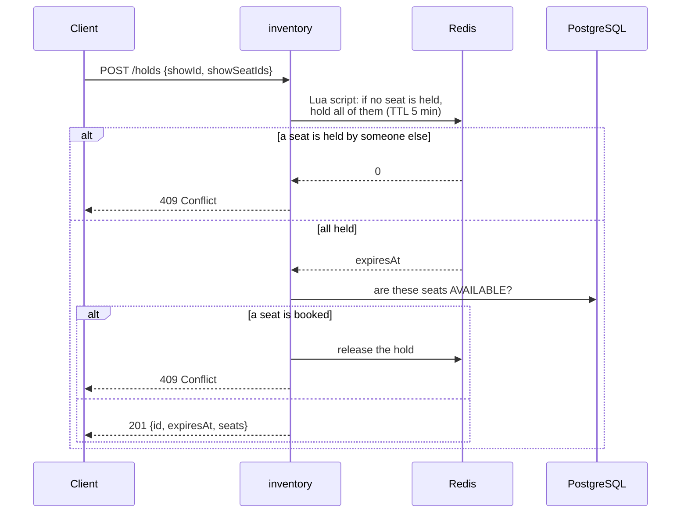
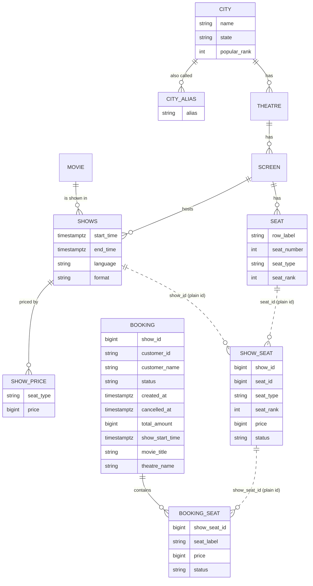

# SeatLock

A movie ticket booking backend (in the spirit of BookMyShow or Ticketmaster) built to answer one question:
**how do you never sell the same seat twice when thousands of people try to book at once?**

It is a modular monolith (Spring Boot 4, Java 25, PostgreSQL 16). It started deliberately simple; each
improvement was made only after a load test showed a real problem; the story is in
[loadtest/results/SUMMARY.md](loadtest/results/SUMMARY.md), every run in
[loadtest/results/RESULTS.md](loadtest/results/RESULTS.md).

- [What it does](#what-it-does)
- [Quick start](#quick-start)
- [Architecture](#architecture)
- [How a booking works](#how-a-booking-works)
- [Data model](#data-model)
- [Performance](#performance)
- [Tests](#tests)
- [Project layout](#project-layout)
- [Not built yet](#not-built-yet)

New here? **[docs/story.md](docs/story.md)** explains the whole app as a story about a cinema, no
programming needed. API reference with request and response examples: **[docs/api.md](docs/api.md)**.

## What it does

1. An admin adds **movies**, **theatres** and **screens** (a screen is a seat layout: rows of seats, each
   row REGULAR, PREMIUM or RECLINER). Every theatre is in a **city** picked from a fixed list; city search
   forgives typos and old names ("chenai", "Madras" → Chennai).
2. The admin schedules a **show**: a movie on a screen at a time. Every seat of the screen becomes a
   bookable **show seat** for that show.
3. A customer opens the **seat map** of a show: the layout (which never changes) plus availability (which
   seats are taken right now).
4. The customer **holds** seats for 5 minutes, either the exact seats they picked on the map or "best
   available N seats of a type", where the server chooses the best adjacent block for them. Nobody else
   can take held seats; a hold that isn't booked expires by itself. Holding is rate limited per user, so a
   script can't keep grabbing and releasing seats.
5. The customer **books** the hold (later: after paying).

26 endpoints in total, all JSON over HTTP. Errors use the standard
[RFC 9457 problem details](https://www.rfc-editor.org/rfc/rfc9457) format.

| Area | Endpoints |
|---|---|
| Catalogue | `GET /cities`, `GET /cities/{id}`, `POST /cities`, `POST /cities/{id}/aliases`, `GET /movies`, `POST /movies`, `GET /movies/{id}`, `GET /theatres`, `POST /theatres`, `GET /theatres/{id}`, `GET /theatres/{id}/shows`, `POST /theatres/{id}/screens`, `GET /screens/{id}`, `GET /shows`, `POST /shows`, `GET /shows/{id}` |
| Seat map | `GET /shows/{id}/layout`, `GET /shows/{id}/availability` |
| Holds | `POST /holds`, `POST /holds/best-available`, `GET /holds/{id}`, `DELETE /holds/{id}` |
| Booking | `POST /bookings`, `GET /bookings`, `GET /bookings/{id}`, `POST /bookings/{id}/cancel` |

Who may call what: `GET` on catalogue and seat maps is public, creating catalogue data needs the `ADMIN`
role, and holds and bookings need a logged-in user. Logins come from **Keycloak**; the backend checks the JWT access
token on every request (details in [docs/api.md](docs/api.md#authentication)). Every booking belongs to the
user who made it (the token's `sub`); users list and open only their own bookings, and anyone else's booking
answers `404`.

## Quick start

Everything runs in Docker.

```bash
cp .env.example .env            # credentials, ports, Keycloak token settings, thread and pool sizes (no defaults in the app)
docker compose up --build -d    # PostgreSQL on :5433, backend on :8080, Keycloak on :8180
curl -s localhost:8080/actuator/health
```

Then walk through the whole flow (ids assume an empty database). Tokens come from Keycloak's dev-only
password login (`jq` extracts them) and last 1 hour (browser logins: 5 minutes): run the two `token` lines
again when calls start returning 401.

```bash
B=localhost:8080
token() { curl -s localhost:8180/realms/seatlock/protocol/openid-connect/token -d grant_type=password \
  -d client_id=seatlock-dev-cli -d username=$1 -d password=$1 | jq -r .access_token; }
ADMIN="Authorization: Bearer $(token admin)"
ASHA="Authorization: Bearer $(token asha)"

curl -s -XPOST $B/movies -H "$ADMIN" -H 'Content-Type: application/json' \
  -d '{"title":"Interstellar","durationMinutes":169,"certification":"UA","releaseDate":"2014-11-07",
       "posterUrl":"https://cdn.example.com/posters/interstellar.jpg","genres":["SCI_FI","DRAMA"]}'
curl -s "$B/cities?query=chenai"   # typo tolerant: Chennai, id 5
curl -s -XPOST $B/theatres -H "$ADMIN" -H 'Content-Type: application/json' \
  -d '{"name":"PVR Grand","cityId":5,"address":"1 Main Road"}'
curl -s -XPOST $B/theatres/1/screens -H "$ADMIN" -H 'Content-Type: application/json' \
  -d '{"name":"Screen 1","rows":[{"label":"A","seatCount":10,"seatType":"REGULAR"},
                                 {"label":"B","seatCount":10,"seatType":"REGULAR"},
                                 {"label":"C","seatCount":8,"seatType":"RECLINER"}]}'
curl -s -XPOST $B/shows -H "$ADMIN" -H 'Content-Type: application/json' \
  -d '{"movieId":1,"screenId":1,"startTime":"2030-01-01T13:30:00Z","language":"ENGLISH","format":"IMAX_2D",
       "prices":{"REGULAR":15000,"RECLINER":40000}}'   # 7:00 PM in India; prices in paise (₹150, ₹400)

curl -s $B/shows/1/layout          # rows and seat ids
curl -s $B/shows/1/availability    # which seat ids are taken

HOLD=$(curl -s -XPOST $B/holds -H "$ASHA" -H 'Content-Type: application/json' \
  -d '{"showId":1,"showSeatIds":[1,2]}' | jq -r .id)     # A1, A2 held for 5 minutes (totalAmount 30000 = ₹300)
curl -s -XPOST $B/bookings -H "$ASHA" -H 'Content-Type: application/json' -d "{\"holdId\":\"$HOLD\"}"
curl -s -XPOST $B/holds/best-available -H "$ASHA" -H 'Content-Type: application/json' \
  -d '{"showId":1,"quantity":2,"seatType":"RECLINER"}'   # then book its id the same way, or let it expire
curl -s -H "$ASHA" $B/bookings/1
curl -s -XPOST -H "$ASHA" $B/bookings/1/cancel   # seats A1, A2 go back on sale
curl -s -H "$ASHA" $B/bookings     # Asha's upcoming bookings, soonest first (?period=PAST for past)
curl -s "$B/movies?cityId=5"       # now showing in Chennai
curl -s "$B/shows?movieId=1&cityId=5&date=2030-01-01"   # its shows that day, by theatre
curl -s "$B/theatres?cityId=5&query=pvr"                 # cinemas in Chennai
curl -s "$B/theatres/1/shows?date=2030-01-01"            # what's playing at one cinema, by movie
```

Holding seats someone else holds or booked returns `409 Conflict`; more than 10 holds in a burst (then 1 every 6 s)
returns `429 Too Many Requests` with `Retry-After`. Without a token, `POST /movies` returns `401`; with
Asha's token (CUSTOMER) it returns `403`.

Logins are handled by **Keycloak** (admin console at [localhost:8180/admin](http://localhost:8180/admin),
credentials from `.env`). The `seatlock` realm comes with test users `admin`/`admin` (ADMIN), `asha`/`asha`
and `ravi`/`ravi` (CUSTOMER); new sign-ups get CUSTOMER. These are local development credentials only.

**Bruno collection:** [bruno/seatlock.bruno.json](bruno/seatlock.bruno.json) holds every request above and
more (66, in 8 folders: log in, health, cities, admin setup, browsing, seat map, holds and bookings, security checks
that must fail), each with tests. Import it in [Bruno](https://www.usebruno.com/), pick the `local`
environment, run "01 Log in", then run the collection; created ids are passed along automatically.

API docs: Swagger UI at [localhost:8080/swagger-ui.html](http://localhost:8080/swagger-ui.html), the OpenAPI
spec at `/v3/api-docs`. Its **Authorize** button logs in through Keycloak (client `seatlock-web`,
authorization code with PKCE) and sends the token with every call. The hand-written reference with examples is [docs/api.md](docs/api.md).

## Architecture

One Spring Boot application split into three modules. Each module owns its own tables in its own
PostgreSQL schema, and modules only talk through small public interfaces or events, so they could later be
split into separate services. Redis holds the short-lived seat holds.



| Module | Owns | Public API (what other modules may use) | Endpoints |
|---|---|---|---|
| **catalogue** | movies, theatres, screens, physical seats, shows | `CatalogueApi`, `ShowSummary`, `ShowScheduled` event | movies, theatres, screens, shows |
| **inventory** | `show_seat`: every seat of every show and its status (AVAILABLE / BOOKED); seat holds (Redis) | `InventoryApi`, `ConfirmedHold`, `BookedSeat` | seat map (layout, availability), holds |
| **booking** | bookings and the seats in each booking | none yet | bookings |

**Dependencies point one way:** booking → inventory → catalogue, and booking → catalogue. Nothing depends on booking.

**Package rule.** Each module is a package under `com.seatlock.backend`:

```
catalogue/
├── CatalogueApi.java           ← public: other modules may import these
├── ShowSummary.java
├── ShowScheduled.java
└── internal/                   ← private to the module, split by feature
    ├── city/                   entity, repositories, service, controller of one feature
    │   └── dto/                its request/response records
    ├── movie/
    ├── theatre/
    ├── screen/
    └── show/
```

Inside `internal/`, a module with several features (catalogue) gets one folder per feature, so the files
that change together sit together. Single-feature modules (inventory, booking) are split by layer instead:
`domain/`, `repository/`, `service/`, `web/` (with `dto/`).

Other modules never import anything from another module's `internal` package. They reference each other's
data by plain id only: no JPA relations and no foreign keys across schemas. `ArchitectureTest` (ArchUnit)
fails the build if a class breaks this rule.

**How the modules connect:**
- **Scheduling a show** (`POST /shows`): catalogue saves the show and publishes a `ShowScheduled` event with
  the screen's seats. Inventory listens and creates one `show_seat` row per seat, copying row, number,
  type and rank so it can serve the seat map without asking catalogue. The listener runs synchronously in
  the same transaction, so a show never exists without its seats.
- **Booking** (`POST /bookings`): booking calls `InventoryApi.confirmHold` to mark the hold's seats BOOKED,
  asks `CatalogueApi` for the show's details (one query), then inserts the booking with a copy of the show
  details. All of it happens in one database transaction, so either everything succeeds or nothing does;
  the hold is deleted from Redis only after the commit. The copy lets "my
  bookings" render and split into upcoming/past by show time without asking catalogue.
- **Cancelling** (`POST /bookings/{id}/cancel`): a guarded update
  `... set status = 'CANCELLED' where id = ? and customer_id = ? and status = 'CONFIRMED' and show_start_time > now`
  decides the winner. Only the request that changed the row releases the seats through `InventoryApi`, in
  the same transaction. This matters: if a double-tapped cancel released the seats twice, the second
  release could free a seat someone else had booked in between, and it would be sold twice.

`shared/` holds cross-cutting code: the global error handler, the exception types that services throw
(`NotFoundException`, `ConflictException`, `TooManyRequestsException`, ...), security, and the Redis-backed
`RateLimiter` that modules apply to their own endpoints (inventory limits holds).

## How a booking works

This is the core of the project. Thousands of requests may target the same few seats at the same moment.
Checkout has two steps, as on any ticket site: **hold** the seats for 5 minutes, then **book** the hold.

### Two stores, two jobs

| | Redis | PostgreSQL |
|---|---|---|
| Holds | seat holds with a 5-minute timer | nothing |
| Sold seats | nothing | `show_seat.status`: AVAILABLE or BOOKED |
| If it loses data | a buyer loses their hold and picks again | not acceptable: the source of truth |

Expiry needs no cleanup job: every hold key has a TTL and Redis deletes it. The seat map shows a seat as
taken if Postgres says BOOKED or Redis holds it.

### Holding seats: `POST /holds`



- **All or nothing.** The Lua script runs inside Redis as one atomic step: either every seat gets a key
  `seat:{show}:{seat}` with the hold id, or none does. Two buyers can never each get half of a row.
- **Hold first, then check Postgres.** Booking deletes a hold's keys only *after* BOOKED is committed. So if
  a new hold got the keys, any earlier booking of those seats is already visible to the check that follows.
  Checking first would leave a gap where a seat is booked between the check and the hold.
- **One hold per user per show.** A new hold replaces the previous one (the script frees its seats), as when
  a buyer goes back and picks other seats.
- **Rate limited per user.** Holding costs a Redis script and a Postgres read, and without a limit one
  account's script could hold and release hundreds of times a second, competing with real buyers for every
  freed seat. Both hold endpoints share a **token bucket** per user (Bucket4j): 10 tokens, refilled at 10 per
  minute, so a buyer changing seats a few times never notices and a script gets one hold every 6 s; beyond
  that `429` with `Retry-After`. Keyed by the user id from the JWT, not the IP: mobile carriers put thousands
  of phones behind one IP. The buckets live in Redis (compare-and-swap updates), so with several backend
  instances a user still gets 10, not 10 per instance. If Redis is down the limit is skipped (fails open): it
  protects capacity, it never decides who gets a seat. Not covered: many accounts (bot detection).

### Booking a hold: `POST /bookings`

1. A second Lua script checks the hold belongs to the caller and keeps its keys alive for at least 60 more
   seconds, so the hold can't expire and be grabbed while the booking is being written.
2. In one transaction: the same guarded update as always,
   `UPDATE show_seat SET status = 'BOOKED' WHERE id IN (...) AND status = 'AVAILABLE' RETURNING id, label`,
   then the booking and its seats are inserted.
3. After the commit, the hold's keys are deleted.

**Why a seat is still never sold twice, even if Redis fails.** The guard `AND status = 'AVAILABLE'` decides,
not Redis. PostgreSQL locks each row it updates, so of two requests racing for seat A5 the second waits,
re-checks, finds it BOOKED and updates nothing; fewer rows than seats means 409 and a rollback. If Redis
restarted and forgot every hold, the worst case is an annoyed buyer, never a double sale. If Redis is down,
holding answers `503` (fails closed).

**Safety net:** a partial unique index (in the `V1__baseline.sql` migration) allows at most one
CONFIRMED booking per show seat. If the application logic ever had a bug, the database would still refuse a
double sale.

### Best available: `POST /holds/best-available`

During a flash sale most buyers want "2 good seats together" and all aim at the same centre seats, so
exact-seat requests collide and most get 409. Best available lets the server choose instead:

1. Every seat has a **rank** computed when the screen is created: 1 is the best seat, nearest the sweet
   spot (60% of the way back, centre of the row; one row away counts like two seats along the row).
2. Inventory reads the available seats of the requested type by rank (no row locks) and drops the ones
   held in Redis.
3. In Java it finds the best block of N seats next to each other in one row (lowest total rank).
4. It holds the block with the same Lua script. If another buyer held one of those seats a moment earlier,
   it picks again, up to 3 times.
5. If no block of N adjacent seats is left: `409 No N adjacent <type> seats available`.

(Before holds this step locked candidate rows with `SELECT ... FOR UPDATE SKIP LOCKED`; Redis now decides
who gets a seat, so the hot path takes no row locks until the booking itself.)

### The seat map: built for many readers

Viewing the map is far more frequent than booking, so it is split in two:

| | `GET /shows/{id}/layout` | `GET /shows/{id}/availability` |
|---|---|---|
| Content | rows, seat ids, numbers, types, prices | count of free seats + ids of taken seats |
| Changes | never (for a show) | on every hold and booking |
| Caching | `Cache-Control: public, max-age=86400, immutable`: browsers and CDNs keep it; in-app cache too | in-app cache for 1 second |
| Size | ~6 KB for 250 seats | ~50 bytes to ~2 KB |

Availability can be up to 1 second stale. That is safe: a hold always re-checks every seat, so a stale map
can only cause a 409, never a double sale. Both responses are cached as
ready-made JSON bytes (Caffeine), so a cache hit skips the database and JSON serialization entirely.

## Data model



Solid lines are real foreign keys inside a schema; dotted lines are plain ids across modules.

- **Seat vs show seat.** `seat` (catalogue) is the physical chair. `show_seat` (inventory) is that chair for
  one show; a 250-seat screen gives 250 show seats per show. Booking changes AVAILABLE → BOOKED.
- **Booking vs booking seat.** Like an order and its order lines: one row per seat, so history survives a
  cancellation and re-sale of the same seat. A partial unique index allows only one CONFIRMED booking seat
  per show seat; cancelled rows drop out of it, so the seat can be sold again.
- **Cities are reference data.** The list (45 Indian cities, 10 marked popular, plus aliases like Madras,
  Bangalore, Gurgaon) is loaded by a migration; theatres point to a city by id, so a misspelt city can't get
  in. Search matches names and aliases by prefix and by trigram similarity (`pg_trgm`), so typos still
  find the right city.
- **Prices.** Set per seat type when a show is created (`show_price`) and fixed after that. Show seats copy
  their price like row and type, so inventory prices a hold alone; booking seats copy it again, so a
  booking keeps what was paid. Money is integer paise (`15000` = ₹150): no rounding, and it is the unit
  payment providers use.
- Times are stored as UTC `timestamptz`. Enums are stored as text.
- The schema is owned by **Flyway**: versioned SQL files in `backend/src/main/resources/db/migration`, applied
  at startup and recorded in `flyway.flyway_schema_history`. Hibernate only validates that the entities match
  (`ddl-auto=validate`); a change to the schema is a new migration file, never an edit of an applied one.

## Performance

Measured on a deliberately small box: an LXD VM with **1 vCPU and 2 GB RAM**, load generated by k6 from the
host. Every step, what it changed and what it gained, plus the experiments that were measured and rejected,
is in [loadtest/results/SUMMARY.md](loadtest/results/SUMMARY.md); every individual run, with its pass
criteria and a detailed report, is in [loadtest/results/RESULTS.md](loadtest/results/RESULTS.md).

| Test | First version | Now | Main changes |
|---|---:|---:|---|
| Seat map views | 710 /s | 4,150 /s | projections instead of entities, layout/availability split, CDN-cacheable layout, 1 s cache of serialized JSON, host networking |
| Bookings | 470 /s | 960 /s | single-statement guarded UPDATE with RETURNING, booking + seats inserted in one statement, tuned thread and connection pool sizes |
| Flash sale (200 users/s on a 1,000-seat show) | failed | sold out in 10.1 s, 0 oversold | faster seat map and booking, then best-available booking with `SKIP LOCKED`: booking attempts −75%, buyers giving up −90%, no failed attempts while seats remained |

Oversold seats in every test so far: **0**. These runs predate seat holds (step 3): booking was then one request, now it is a hold plus a booking.

## Tests

```bash
docker compose run --rm backend-test    # Maven in Docker; Testcontainers starts a throwaway PostgreSQL 16 and Redis 8
```

Tests run against a **real PostgreSQL** with every Flyway migration applied and a **real Redis**, and talk to the app over **real
HTTP** on a random port, so security filters, error handling, JSON and SQL are all part of each test. Each test
creates its own city, theatre, show and users, so tests are independent of each other and of their order.
Logins don't need Keycloak: a test-only `JwtDecoder` turns test tokens into JWTs, while the real role mapping
and ownership checks run unchanged (the real Keycloak path is covered by the Bruno collection).

| Test | What it proves |
|---|---|
| `BookingConcurrencyTest` | 20 buyers racing for the same seats: exactly 1 wins, also with seat ids in opposite orders; 30 parallel best-available buyers never share a seat and all can book; a double-tapped confirm books once; 10 simultaneous cancels release the seats once |
| `BookingApiTest` | owner taken from the token, show copy on the booking, a booked hold is gone from Redis, 409 for taken seats, only the holder can book a hold, others' bookings are 404, upcoming/past split, cancel, idempotent cancel, no cancel after the show started |
| `HoldRateLimitTest` | the 11th hold in a burst is 429 with `Retry-After` and problem details, the bucket lives in Redis with an expiry, both hold endpoints share it, other users keep their own bucket, release and booking aren't limited |
| `HoldApiTest` | a hold lasts 5 minutes (TTL set in Redis), held seats are 409 for others and unavailable on the seat map, release, expiry frees the seats and the expired hold can't be booked, a new hold replaces the old one, others' holds are 404, booked seats can't be held, best-available blocks skip held seats, validation |
| `BookingConstraintsTest` | the database itself refuses bad states: a cancelled booking without a time, unknown statuses, one seat in two confirmed bookings |
| `SecurityRulesTest` | public reads, 401 with problem details and `WWW-Authenticate`, invalid tokens, 403 for customers on admin endpoints, unknown paths closed by default |
| `CatalogueApiTest`, `SeatMapApiTest` | typo-tolerant city search, validation errors per field, a new show appears in now showing, showtimes and the theatre page; seat map layout and availability |
| `ArchitectureTest` (ArchUnit) | module boundaries: no module uses another's `internal` package, catalogue depends on no other module, nothing depends on booking |
| `CurrentUserTest`, `IndiaTimeTest`, `GlobalExceptionHandlerTest`, `RateLimiterTest` | unit tests: name fallbacks from the token, the India day boundary, 503 when Redis is unreachable, `Retry-After` rounded up to whole seconds, the rate limit lets requests through when Redis fails |

## Project layout

```
backend/              Spring Boot application (Dockerfile, pom.xml, src/)
keycloak/             Keycloak realm (roles, login clients, test users), imported on first start
docker-compose.yml    postgres + redis + backend + keycloak; profiles: monitoring (Prometheus, postgres-exporter), cdn (nginx edge)
docker-compose.vm.yml host networking overrides for the load-test VM
.env.example          every setting the app needs (copy to .env)
loadtest/results/     SUMMARY.md: performance story; RESULTS.md + runs/: every load-test run and its report
monitoring/           Prometheus config, PostgreSQL init (pg_stat_statements)
docs/                 api.md (API reference), story.md (the app explained as a story)
bruno/                Bruno collection: every endpoint with tests, importable
```

Configuration comes only from environment variables (see `.env.example`); there are no defaults in the
app, so a missing value fails at startup instead of silently using a wrong one. Metrics are exposed at
`/actuator/prometheus`.

## Not built yet

Deliberately left out until a test or feature needs them:

- **Payment** and refunds (a hold is booked without paying; a cancelled booking just frees its seats).
- **Flash-sale protection**: admission control and a waiting room for traffic beyond capacity.
- Notifications, search.
- Show overlap checks.
- **Horizontal scaling**: holds and rate limits already live in Redis; the availability cache stays per instance
  (Caffeine) on purpose: sharing it in Redis would turn every ~1 µs hit into a network round trip to save a few
  database queries per second per show. To be measured once there are several instances.
