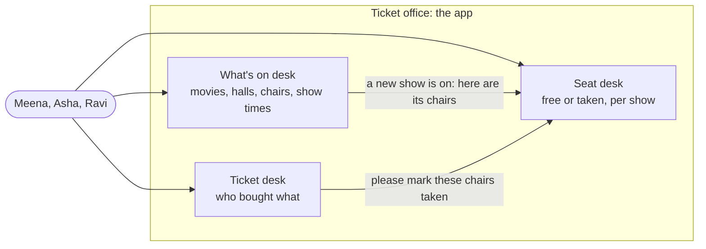
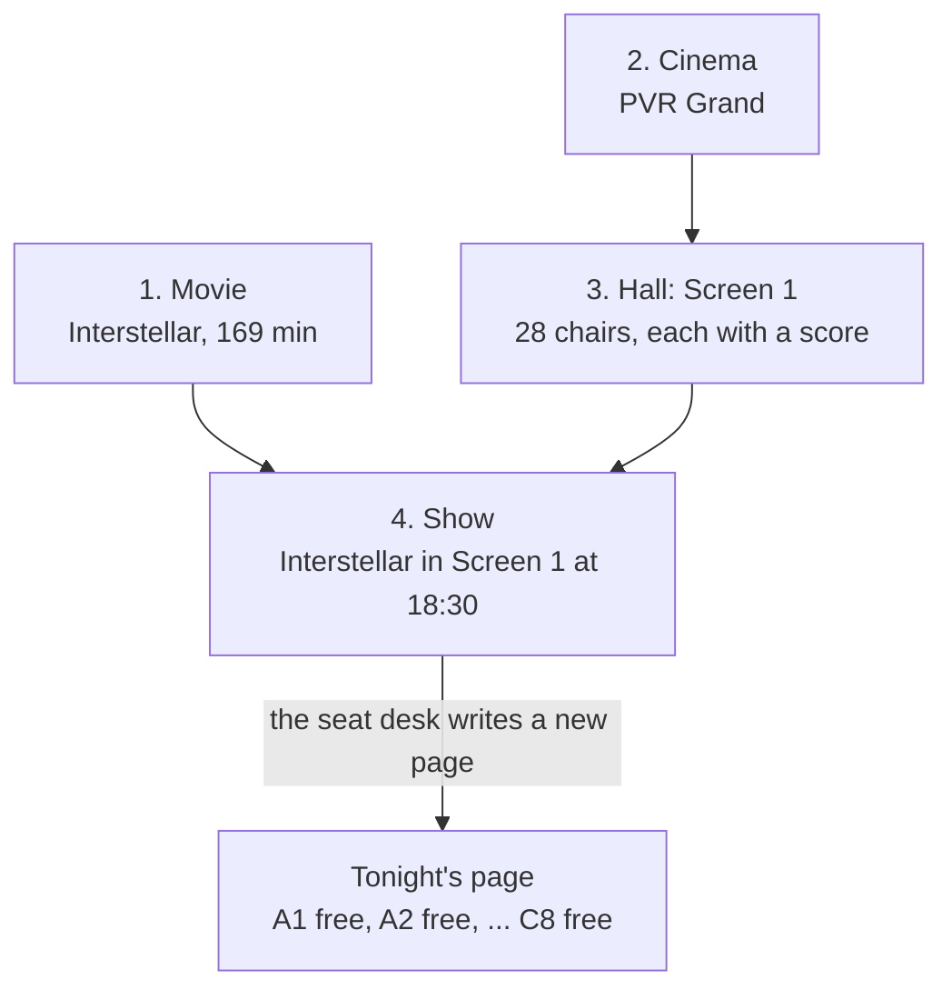
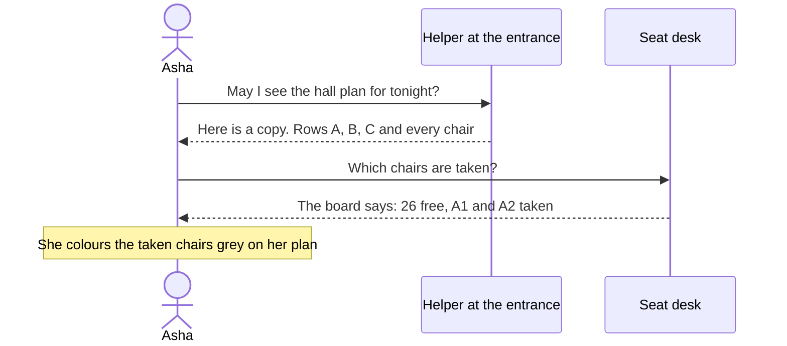
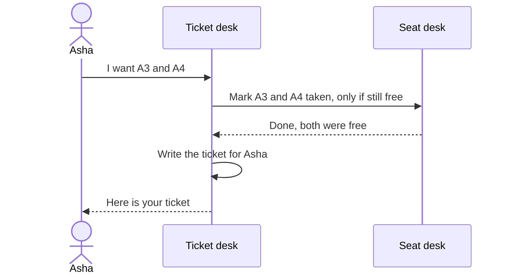
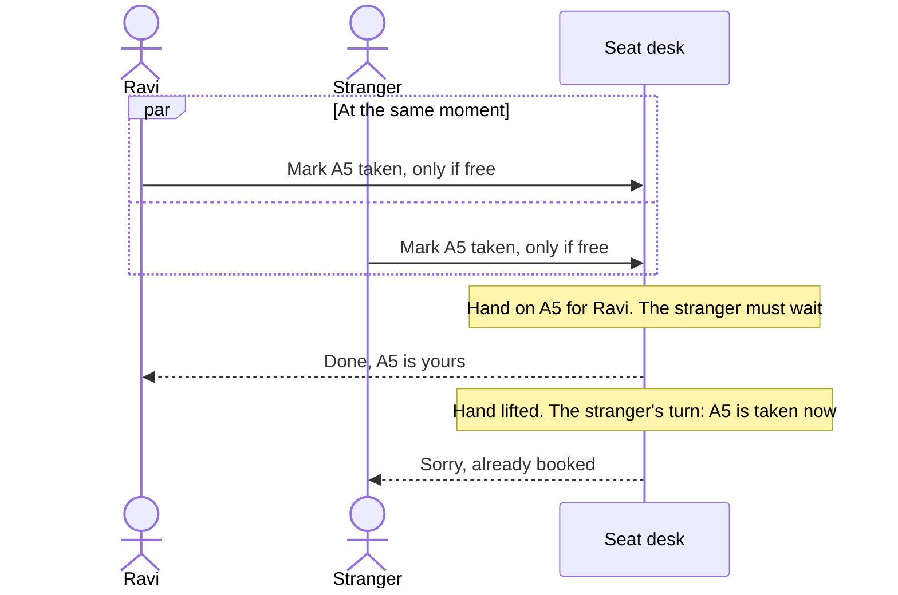
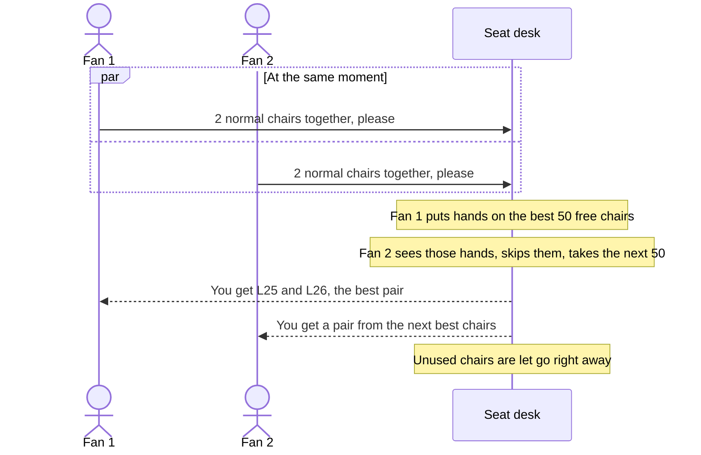

# The SeatLock story

How the app works, told as a story about a cinema. No programming knowledge needed. Each chapter has
three parts: **what happens** in everyday words, a **picture**, and **behind the counter**: what the app
really does. The technical words are collected in the [glossary](#glossary-everyday-words-for-technical-ideas)
at the end.

For the technical overview see the [README](../README.md); for every endpoint see [api.md](api.md).

- [Meet the cinema](#meet-the-cinema)
- [Chapter 1: Getting a show ready](#chapter-1-getting-a-show-ready)
- [Chapter 2: Looking at the seats](#chapter-2-looking-at-the-seats)
- [Chapter 3: Buying a ticket](#chapter-3-buying-a-ticket)
- [Chapter 4: Two people, one chair](#chapter-4-two-people-one-chair)
- [Chapter 5: The big rush](#chapter-5-the-big-rush)
- [Chapter 6: Sold out](#chapter-6-sold-out)
- [Glossary](#glossary-everyday-words-for-technical-ideas)
- [Not in the story yet](#not-in-the-story-yet)

## Meet the cinema

Think of SeatLock as the **ticket office of a cinema**. Inside the office there are three desks, and each
desk keeps its own notebook:

| Desk | What it knows | In the app |
|---|---|---|
| **What's on desk** | which movies exist, which halls the cinema has, where every chair stands, and which movie plays when | the `catalogue` module |
| **Seat desk** | for every show, which chairs are still free and which are taken | the `inventory` module |
| **Ticket desk** | who bought which chairs | the `booking` module |

The desks never read each other's notebooks. If the ticket desk needs a chair marked as taken, it **asks**
the seat desk. That way each desk can be sure its notebook is always right.

The people in our story:
- **Meena**, the cinema owner, who sets everything up.
- **Asha** and **Ravi**, two friends who both want to watch *Interstellar* tonight.
- Later, **ten thousand fans** who all want tickets the second they go on sale.

**The wristband at the door.** Anyone may look at the posters, the show times and the hall plan. To do
more, you first visit the **front desk** (Keycloak), say who you are, and get a **wristband** (a token).
The wristband shows your name, its colour shows what you may do (a customer band, or Meena's staff band),
and it stops working after 5 minutes. Every desk checks the wristband itself, by looking at the front
desk's stamp on it: there's no need to phone the front desk each time. With no band, or a fake or
expired one, a desk says "please get a wristband first" (`401`). A customer band at the staff-only
counter gets "not for you" (`403`): only Meena may add movies or shows, while anyone with a band may buy
tickets.

## Chapter 1: Getting a show ready

**What happens.** Meena tells the office four things, one after the other:

1. **The movie**: "*Interstellar*, 169 minutes, rated UA."
2. **The cinema**: "PVR Grand, in Chennai."
3. **The hall**: "Screen 1 has row A with 10 chairs, row B with 10 chairs, and row C with 8 big reclining
   chairs at the back."
4. **The show**: "*Interstellar* plays in Screen 1 tonight at 18:30."

When the hall is described, the office also gives **every chair a score**: chair number 1 is the best one,
the one you would pick if you could have any. Good chairs are a bit more than halfway back and in the
middle of the row. Chairs at the very front corner get the worst scores.

When the show is added, something important happens: the what's on desk tells the seat desk "there is a new
show, here are all its chairs". The seat desk writes a fresh page for that show with **every chair marked
free**. Screen 1 has 28 chairs, so the page for tonight's show has 28 lines.

**Behind the counter.**
- The four steps are `POST /movies`, `POST /theatres`, `POST /theatres/1/screens` and `POST /shows`.
- A cinema is filed under its **city**, chosen from the office's fixed list of towns (`cityId`), never
  written by hand. That's why "Chennai" and "chenai" can't become two towns. Visitors asking for "Madras"
  or "chenai" are still pointed to Chennai (`GET /cities?query=`).
- The chair score is the **seat rank**. It is computed once, when the screen is created, from how far the
  chair is from the sweet spot (60% of the way back, centre of the row).
- A **chair** (`seat`) belongs to the hall forever. A **chair for one evening** (`show_seat`) belongs to a
  show. The same chair A1 has a different show seat for every show: free tonight, maybe taken tomorrow.
- The message from the what's on desk to the seat desk is the `ShowScheduled` event. Both notebooks are
  updated together: there is never a show without its chairs.

## Chapter 2: Looking at the seats

**What happens.** Asha opens the app to see tonight's show. She sees a picture of the hall with free chairs
in green and taken chairs in grey.

That picture is made of two parts:

- **The hall plan**: where the rows and chairs are. It never changes for a show, so the office printed lots of
  copies and handed them to helpers standing near the entrance. Asha gets a copy from a helper without
  even reaching the counter.
- **The "taken" board**: a small list of which chairs are already sold. This one changes all the time, so
  Asha asks the office every time she looks. To stay fast, the office rewrites the board **once every
  second** instead of checking its notebook for every single person who asks.

**Behind the counter.**
- The hall plan is `GET /shows/{id}/layout`. Its answer says "you may keep this for a day", so browsers and
  a **CDN** (the helpers at the entrance) keep copies, and most people never reach the app at all.
- The taken board is `GET /shows/{id}/availability`. The app keeps the answer in memory for 1 second
  (a **cache**), so a thousand people looking in the same second cost the database one question, not a
  thousand.
- Because the board can be up to a second old, Asha might see a chair as free that was sold half a second
  ago. That is fine, because of what happens in the next chapter.

## Chapter 3: Buying a ticket

**What happens.** Asha picks chairs A3 and A4 and presses "Book".

The ticket desk does not trust the picture on Asha's phone (it could be a second old). It asks the seat desk
one careful question:

> "Please mark A3 and A4 as taken, **but only if they are still free right now.**"

The seat desk checks its notebook, finds both chairs free, marks them taken, and says "done". The ticket desk
then writes Asha's ticket: *Asha, tonight's show, chairs A3 and A4*. Both notebooks are updated **together**:
if anything goes wrong halfway, neither notebook changes. Asha never ends up with chairs but no ticket, or
a ticket but no chairs.

**Behind the counter.**
- This is `POST /bookings` with `showSeatIds: [3, 4]`. The answer is `201 Created` with the ticket.
- "Only if still free" is one database statement:
  `UPDATE show_seat SET status = 'BOOKED' WHERE id IN (3, 4) AND status = 'AVAILABLE'`.
  If fewer chairs were updated than asked for, the whole booking is cancelled and nothing changes.
- "Both notebooks together" is a **transaction**: all of it happens, or none of it does.

## Chapter 4: Two people, one chair

**What happens.** Ravi wants chair A5. So does a stranger. They both press "Book" at **exactly the same
moment**.

The seat desk has a simple rule: **when someone is handling a chair, they put their hand on it**, and anyone
else who wants that chair must wait until the hand is lifted.

1. Ravi's request arrives a tiny moment first. The seat desk puts a hand on A5, sees it is free, marks it
   taken.
2. The stranger's request wants A5 too, sees the hand, and **waits**.
3. Ravi's booking finishes and the hand is lifted.
4. The stranger's request now looks at A5 again, sees it is **taken**, and gets "Sorry, that seat is
   already booked."

Only one person can ever win a chair. And there is a second safety rule in the ticket notebook itself:
**it will refuse to write two valid tickets for the same chair**, even if everything else went wrong.

**Behind the counter.**
- The hand on the chair is a **row lock**: PostgreSQL locks a row while one transaction changes it.
- "Sorry, already booked" is the answer `409 Conflict`.
- The second safety rule is a **unique index** on the ticket lines: at most one confirmed ticket per
  show seat.
- The load tests have made hundreds of thousands of bookings, with many people racing for the same chairs.
  Chairs sold twice so far: **zero**.

## Chapter 5: The big rush

**What happens.** A huge movie goes on sale. The hall has 1,000 chairs, and **200 new fans arrive every
second**.

**The problem.** At first, every fan looked at the seat picture and picked chairs themselves. But everyone
wants nearly the same chairs: the good ones in the middle. So it went like this, thousands of times:

> Fan 1 picks C10 and C11. Fan 2 picks C10 and C11. Fan 3 picks C10 and C11...
> Only one of them wins. Everyone else hears "Sorry, taken", looks again, picks again, loses again.

In the test, **93 out of every 100 tries failed**, and 1,627 fans gave up angry even though chairs were
still free.

**The fix: "best available".** Instead of picking chairs, the fan just says how many and what kind:

> "**2 normal chairs together, please.** You choose."

The seat desk now picks for them:

1. It looks at the 50 best free chairs (by their score from chapter 1) and **puts a hand on all of them**.
2. If another fan's request already has a hand on some chair, it **does not wait**: it simply skips that
   chair and takes the next free one. So fans standing in line at the same time get **different** chairs
   instead of fighting over the same ones.
3. It finds the best two chairs side by side in one row, marks them taken, and lets go of the rest.
4. If no two chairs side by side are left, the answer is "Sorry, no 2 seats together left".

**What changed** (same 200 fans per second, same 1,000 chairs):

| | Fans pick chairs | Best available |
|---|---:|---:|
| Time until every chair was sold | 17.5 seconds | **10.1 seconds** |
| Booking tries in total | 6,412 | **1,627** |
| Tries that failed while chairs were still free | most of them | **almost none** |
| Fans who gave up | 1,627 | **160** |
| Chairs sold twice | 0 | **0** |

**Behind the counter.**
- This is `POST /bookings/best-available` with `{"quantity": 2, "seatType": "REGULAR"}`.
- "Put a hand on the 50 best free chairs, skip chairs someone else is holding" is
  `SELECT ... ORDER BY seat_rank LIMIT 50 FOR UPDATE SKIP LOCKED`.
- The pair is then booked with the same "only if still free" statement as in chapter 3, so all the safety
  rules from chapter 4 still apply.

## Chapter 6: Sold out

**What happens.** Ten seconds after the sale opened, the last chair is gone. Fans who arrive now see a board
saying "0 free" and leave straight away.

A few fans were unlucky in between: they looked at the board, it still said "3 free", they thought for a
moment, and by the time they pressed "Book" those chairs were gone. They hear "Sorry, no seats together
left". The board was simply a second behind, and they took a few seconds to decide.

**Behind the counter.**
- Almost all failed tries in the rush happen in these last seconds around the sell-out.
- The real fix is a **hold**: the moment a fan starts buying, their chairs show as "reserved" for a few
  minutes while they pay. That is the next big feature (see below).

## Glossary: everyday words for technical ideas

| In the app | In the cinema story |
|---|---|
| Module (`catalogue`, `inventory`, `booking`) | A desk in the ticket office, with its own notebook |
| Database schema | Each desk's own notebook |
| Seat (`seat`) | A chair in the hall, there forever |
| Show seat (`show_seat`) | That chair for one evening's show |
| Seat rank | The chair's score: 1 is the best chair in the hall |
| Event (`ShowScheduled`) | The what's on desk telling the seat desk "a new show is on, here are its chairs" |
| Layout (`/layout`) | The printed hall plan |
| CDN | Helpers at the entrance handing out copies of the hall plan |
| Availability (`/availability`) | The "taken" board |
| Cache (1 second) | Rewriting the board once a second instead of for every person who asks |
| Transaction | Writing in both notebooks together: all of it or none of it |
| Row lock | Putting your hand on a chair: others must wait |
| `SKIP LOCKED` | Seeing a hand on a chair and walking to the next free one instead of waiting |
| `409 Conflict` | "Sorry, that seat is taken" |
| Unique index | The ticket notebook refusing to write two tickets for one chair |
| Load test (k6) | A rehearsal with thousands of pretend fans |
| Keycloak | The front desk that checks who you are and hands out wristbands |
| Access token (JWT) | The wristband: your name, your colour, an expiry time and the front desk's stamp |
| Role (`CUSTOMER`, `ADMIN`) | The colour of the wristband |
| `401` / `403` | "Get a wristband first" / "Your wristband doesn't open this counter" |

## Not in the story yet

- **Holding chairs while you pay**: today a ticket is final the moment you book.
- **Paying**, cancelling, refunds.
- **A queue at the door** for when far more fans arrive than the office can serve.
- **Your own tickets**: you need a wristband to buy, but a ticket still just has a name written on it,
  and anyone with a band can look up any ticket number. Soon tickets belong to the person who bought them.
