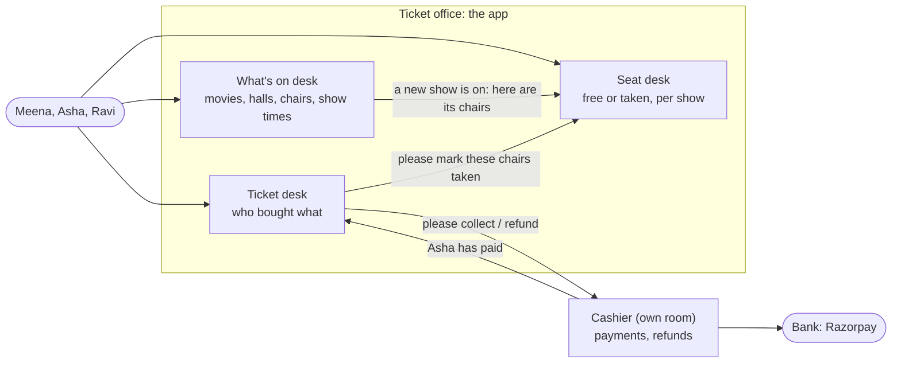
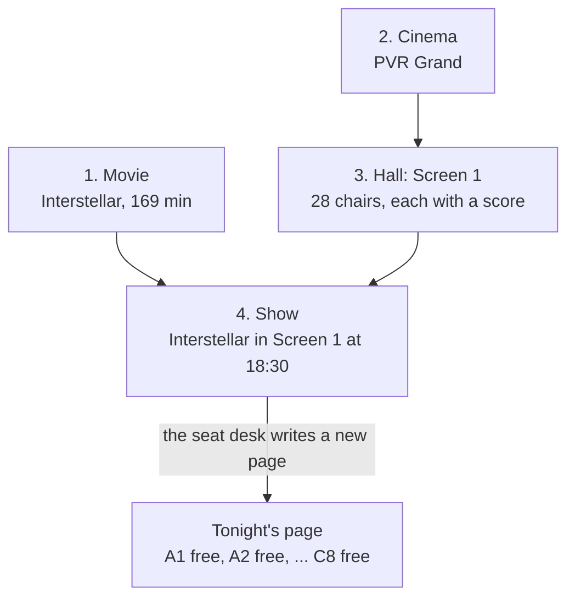
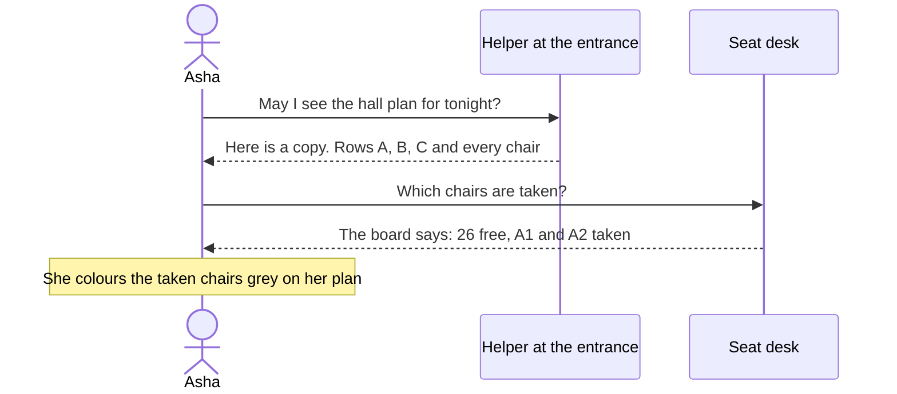
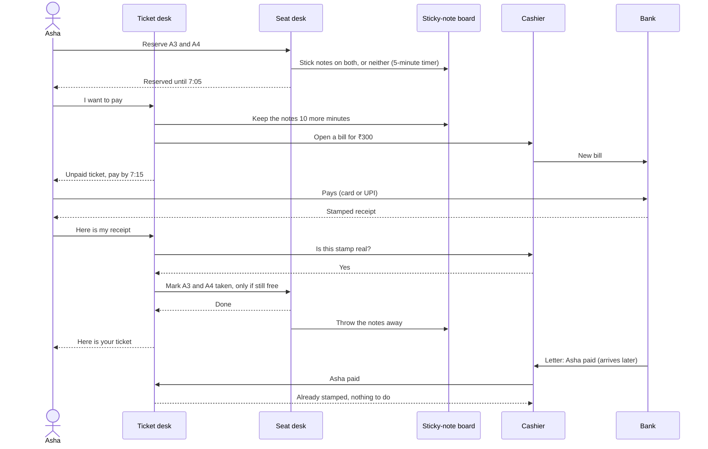
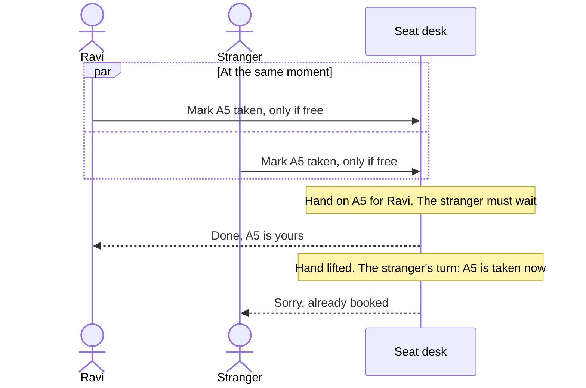
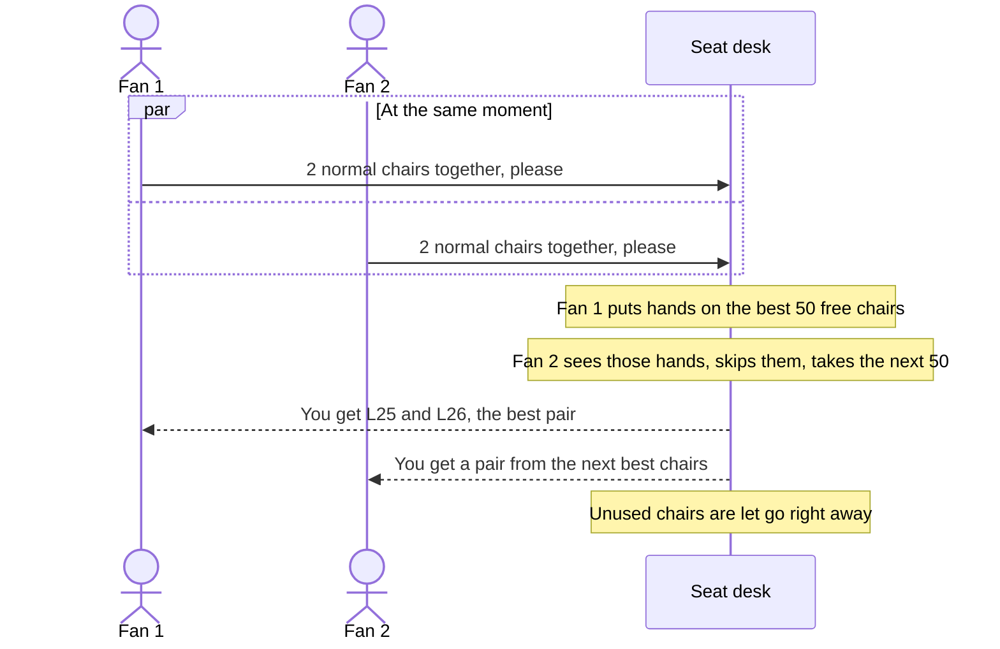

# The SeatLock story

How the app works, told as a story about a cinema. No programming knowledge needed. Each chapter has
three parts: **what happens** in everyday words, a **picture**, and **behind the counter**: what the app
really does. The technical words are collected in the [glossary](#glossary-everyday-words-for-technical-ideas)
at the end.

For the technical overview see the [README](../README.md); for every endpoint see [api.md](api.md).

- [Meet the cinema](#meet-the-cinema)
- [Chapter 1: Getting a show ready](#chapter-1-getting-a-show-ready)
- [Chapter 2: Looking at the seats](#chapter-2-looking-at-the-seats)
- [Chapter 3: Buying a ticket](#chapter-3-buying-a-ticket)
- [Chapter 4: Two people, one chair](#chapter-4-two-people-one-chair)
- [Chapter 5: The big rush](#chapter-5-the-big-rush)
- [Chapter 6: Sold out](#chapter-6-sold-out)
- [Glossary](#glossary-everyday-words-for-technical-ideas)
- [Not in the story yet](#not-in-the-story-yet)

## Meet the cinema

Think of SeatLock as the **ticket office of a cinema**. Inside the office there are three desks, and each
desk keeps its own notebook:

| Desk | What it knows | In the app |
|---|---|---|
| **What's on desk** | which movies exist, which halls the cinema has, where every chair stands, and which movie plays when | the `catalogue` module |
| **Seat desk** | for every show, which chairs are still free and which are taken | the `inventory` module |
| **Ticket desk** | who bought which chairs | the `booking` module |

Next door, in a separate room with its own locked notebook, sits the **cashier** (the payment service).
The cashier talks to the **bank** (Razorpay) and is the only one who knows the bank's secret code words.

The desks never read each other's notebooks. If the ticket desk needs a chair marked as taken, it **asks**
the seat desk. That way each desk can be sure its notebook is always right.

The people in our story:
- **Meena**, the cinema owner, who sets everything up.
- **Asha** and **Ravi**, two friends who both want to watch *Interstellar* tonight.
- Later, **ten thousand fans** who all want tickets the second they go on sale.

**The wristband at the door.** Anyone may look at the posters, the show times and the hall plan. To do
more, you first visit the **front desk** (Keycloak), say who you are, and get a **wristband** (a token).
The wristband shows your name, its colour shows what you may do (a customer band, or Meena's staff band),
and it stops working after 5 minutes. Every desk checks the wristband itself, by looking at the front
desk's stamp on it: there's no need to phone the front desk each time. With no band, or a fake or
expired one, a desk says "please get a wristband first" (`401`). A customer band at the staff-only
counter gets "not for you" (`403`): only Meena may add movies or shows, while anyone with a band may buy
tickets.

The ticket desk writes the wristband's number on every ticket it sells, not whatever name the buyer says.
It also copies the movie, the hall and the time onto the ticket, so the ticket says what was sold even if
the posters change later, and Asha's "my tickets" list can show coming shows first and old ones apart.

If Asha can't go, she can hand her ticket back before the show starts. The desk stamps it "cancelled"
(she keeps it in her list), tells the seat desk to put her chairs back on sale and asks the cashier to give
her money back. If she nervously hands
it back twice, only the first stamp counts: otherwise the second could free a chair Ravi has just bought.
Later, Asha can ask "show me my tickets" and gets only hers. If Ravi asks for Asha's ticket number, the desk
says "no such ticket" (`404`), as if it didn't exist, so nobody can find out which ticket numbers are
taken.

## Chapter 1: Getting a show ready

**What happens.** Meena tells the office four things, one after the other:

1. **The movie**: "*Interstellar*, 169 minutes, rated UA."
2. **The cinema**: "PVR Grand, in Chennai."
3. **The hall**: "Screen 1 has row A with 10 chairs, row B with 10 chairs, and row C with 8 big reclining
   chairs at the back."
4. **The show**: "*Interstellar* plays in Screen 1 tonight at 18:30. Ordinary chairs ₹150, recliners ₹400."

When the hall is described, the office also gives **every chair a score**: chair number 1 is the best one,
the one you would pick if you could have any. Good chairs are a bit more than halfway back and in the
middle of the row. Chairs at the very front corner get the worst scores.

When the show is added, something important happens: the what's on desk tells the seat desk "there is a new
show, here are all its chairs". The seat desk writes a fresh page for that show with **every chair marked
free** and its price next to it. Screen 1 has 28 chairs, so the page for tonight's show has 28 lines.
Tomorrow's matinee can have other prices; once a show is announced, its prices don't change.

**Behind the counter.**
- The four steps are `POST /movies`, `POST /theatres`, `POST /theatres/1/screens` and `POST /shows`.
- A cinema is filed under its **city**, chosen from the office's fixed list of towns (`cityId`), never
  written by hand. That's why "Chennai" and "chenai" can't become two towns. Visitors asking for "Madras"
  or "chenai" are still pointed to Chennai (`GET /cities?query=`).
- The chair score is the **seat rank**. It is computed once, when the screen is created, from how far the
  chair is from the sweet spot (60% of the way back, centre of the row).
- A **chair** (`seat`) belongs to the hall forever. A **chair for one evening** (`show_seat`) belongs to a
  show. The same chair A1 has a different show seat for every show: free tonight, maybe taken tomorrow.
- The message from the what's on desk to the seat desk is the `ShowScheduled` event. Both notebooks are
  updated together: there is never a show without its chairs.
- Prices are per **seat type** for one show (`prices` in `POST /shows`, every type the hall has). They are
  written in paise (`15000` = ₹150), whole numbers, so sums never get rounding errors. The seat desk copies
  the price onto every chair's line, and later the ticket copies it again, so a ticket always says what was
  paid.

## Chapter 2: Looking at the seats

**What happens.** Asha opens the app to see tonight's show. She sees a picture of the hall with free chairs
in green and taken chairs in grey.

That picture is made of two parts:

- **The hall plan**: where the rows and chairs are. It never changes for a show, so the office printed lots of
  copies and handed them to helpers standing near the entrance. Asha gets a copy from a helper without
  even reaching the counter.
- **The "taken" board**: a small list of which chairs are already sold. This one changes all the time, so
  Asha asks the office every time she looks. To stay fast, the office rewrites the board **once every
  second** instead of checking its notebook for every single person who asks.

**Behind the counter.**
- The hall plan is `GET /shows/{id}/layout`. Its answer says "you may keep this for a day", so browsers and
  a **CDN** (the helpers at the entrance) keep copies, and most people never reach the app at all.
- The taken board is `GET /shows/{id}/availability`. The app keeps the answer in memory for 1 second
  (a **cache**), so a thousand people looking in the same second cost the database one question, not a
  thousand.
- Because the board can be up to a second old, Asha might see a chair as free that was sold half a second
  ago. That is fine, because of what happens in the next chapter.

## Chapter 3: Buying a ticket

**What happens.** Asha picks chairs A3 and A4 and presses "Continue". Buying takes three steps, like at any
real ticket counter: reserve, pay, get the ticket.

**Step 1: the sticky notes.** Next to its notebook, the seat desk has a **board of sticky notes** with a
timer on each. It writes "reserved for Asha" on two notes and sticks them on A3 and A4, both at once: if
someone already has a note on either chair, it sticks neither and says "Sorry, taken". Then it glances at
its notebook to make sure neither chair was already sold. Asha now has **5 minutes**. Everyone else's
board shows A3 and A4 as taken. If Asha walks away or takes too long, the notes simply fade and the chairs
are free again. Nobody has to go round removing them. If she taps "back", the desk peels them off at once.
If she picks other chairs instead, her old notes go and new ones are stuck on.

**Step 2: paying.** Asha presses "Pay". The ticket desk writes an **unpaid ticket** (*Asha, A3 and A4,
₹300, pay by 7:15*), asks the seat desk to keep her sticky notes for **10 more minutes**, and asks the
cashier to open a bill with the bank. Asha pays the bank directly, at the bank's own window (Razorpay
Checkout): the cinema never sees her card. If her card is declined she can try UPI at the same window; the
bill stays open.

**Step 3: the ticket.** The bank gives Asha a **receipt with a stamp** only the bank and the cashier can
check. She shows it at the ticket desk, the cashier checks the stamp, and only then does the ticket desk ask
the seat desk one careful question:

> "Please mark A3 and A4 as taken in your notebook, **but only if they are still free right now.**"

They are, so the seat desk marks them taken and the ticket desk stamps Asha's ticket **paid**. Both
notebooks are updated **together**: if anything goes wrong halfway, neither notebook changes. Only then are
the sticky notes thrown away.

**And if her phone dies after paying?** The bank also sends the cashier a signed letter: "Asha paid bill
42". The cashier tells the ticket desk, which does exactly the same as step 3. Whichever arrives second (her
receipt or the letter) finds the ticket already stamped and changes nothing. If the ticket desk is closed
when the letter comes, the cashier says "try again later" and the bank sends the letter again.

**Paid, but the chairs are gone.** If Asha's notes faded before her money arrived (or she started picking
other chairs meanwhile), the ticket desk can't give her A3 and A4. It stamps the ticket "failed" and the
cashier gives the money back at once. If she never pays, a clerk walks round every 30 seconds and stamps
overdue unpaid tickets "expired".

**Behind the counter.**
- Step 1 is `POST /holds` with `showSeatIds: [3, 4]`; the answer has the hold's id, `expiresAt` (the
  timer) and `totalAmount` (what the chairs cost together). The sticky-note board is **Redis**, and the
  fading timer is a **TTL** on every key. Sticking all notes or none is a small **Lua script** that Redis
  runs in one go.
- Step 2 is `POST /bookings` with the hold's id: a `PENDING_PAYMENT` booking and a Razorpay order. The
  cashier is the separate **payment service**, with its own database; the desks talk to it over HTTP, each
  showing its own staff wristband (a **client credentials** token).
- Step 3 is `POST /bookings/{id}/payment` with Razorpay's three values. The stamp is an **HMAC signature**.
  "Only if still free" is one database statement:
  `UPDATE show_seat SET status = 'BOOKED' WHERE id IN (3, 4) AND status = 'AVAILABLE'`.
  If fewer chairs were updated than asked for, nothing changes.
- The bank's letter is a **webhook** (`payment.captured`); the cashier passes it on with
  `POST /internal/bookings/{id}/paid`. Doing the same thing twice safely is called **idempotent**.
- "Both notebooks together" is a **transaction**: all of it happens, or none of it does. Nobody ever waits
  for the bank inside one.
- The notebook (PostgreSQL) has the last word, not the notes. If the sticky-note board fell off the wall
  and every note was lost, people would have to pick their chairs again, but a chair still could not be
  sold twice.

**A pad of sticky notes per person.** One day a man with a stopwatch stands at the board, sticking notes on
the best chairs and pulling them off again, hundreds of times a minute, so that whenever a chair comes
free his hand is already there. Now everyone gets a **small pad of 10 notes**; the board hands out one
fresh note every 6 seconds, up to 10. A family changing their mind a few times never runs out. The man
with the stopwatch runs out in a second, and then hears "Wait 6 seconds". The pads are kept at the board
itself, so it doesn't matter which window he walks up to.

- That is a per-user **rate limit** (a **token bucket**, Bucket4j) on `POST /holds` and
  `POST /holds/best-available`: beyond it `429 Too Many Requests` with a `Retry-After` header. It counts
  per wristband (the user id in the token), not per address: many phones share one address.
- The pads are kept in Redis, so several seat desks (backend instances) share them. If the board is
  down, the pad check is skipped; nobody can stick notes then anyway.

## Chapter 4: Two people, one chair

**What happens.** Ravi wants chair A5. So does a stranger. They both press "Continue" at **exactly the same
moment**.

The sticky-note board takes **one request at a time**, so one of them gets the note on A5 and the other
hears "Sorry, taken". That settles most fights. But the notebook has its own rule too, for the moment
someone presses "Book", so that even a mistake with the notes could never sell a chair twice: **when someone is handling a chair, they put their hand on it**, and anyone
else who wants that chair must wait until the hand is lifted.

1. Ravi's booking arrives a tiny moment first. The seat desk puts a hand on A5, sees it is free, marks it
   taken.
2. Another booking for A5 sees the hand, and **waits**.
3. Ravi's booking finishes and the hand is lifted.
4. The other booking now looks at A5 again, sees it is **taken**, and gets "Sorry, that seat is already
   booked."

Only one person can ever win a chair. And there is a second safety rule in the ticket notebook itself:
**it will refuse to write two valid tickets for the same chair**, even if everything else went wrong.

**Behind the counter.**
- Redis runs one command or script at a time, so of two holds racing for A5 exactly one wins; the other
  gets `409`. A test races 20 buyers for the same seats: one hold, one booking.
- The hand on the chair is a **row lock**: PostgreSQL locks a row while one transaction changes it.
- "Sorry, already booked" is the answer `409 Conflict`.
- The second safety rule is a **unique index** on the ticket lines: at most one confirmed ticket per
  show seat.
- The load tests have made hundreds of thousands of bookings, with many people racing for the same chairs.
  Chairs sold twice so far: **zero**.

## Chapter 5: The big rush

**What happens.** A huge movie goes on sale. The hall has 1,000 chairs, and **200 new fans arrive every
second**.

**The problem.** At first, every fan looked at the seat picture and picked chairs themselves. But everyone
wants nearly the same chairs: the good ones in the middle. So it went like this, thousands of times:

> Fan 1 picks C10 and C11. Fan 2 picks C10 and C11. Fan 3 picks C10 and C11...
> Only one of them wins. Everyone else hears "Sorry, taken", looks again, picks again, loses again.

In the test, **93 out of every 100 tries failed**, and 1,627 fans gave up angry even though chairs were
still free.

**The fix: "best available".** Instead of picking chairs, the fan just says how many and what kind:

> "**2 normal chairs together, please.** You choose."

The seat desk now picks for them:

1. It looks at the 50 best free chairs (by their score from chapter 1) and **puts a hand on all of them**.
2. If another fan's request already has a hand on some chair, it **does not wait**: it simply skips that
   chair and takes the next free one. So fans standing in line at the same time get **different** chairs
   instead of fighting over the same ones.
3. It finds the best two chairs side by side in one row, marks them taken, and lets go of the rest.
4. If no two chairs side by side are left, the answer is "Sorry, no 2 seats together left".

**What changed** (same 200 fans per second, same 1,000 chairs):

| | Fans pick chairs | Best available |
|---|---:|---:|
| Time until every chair was sold | 17.5 seconds | **10.1 seconds** |
| Booking tries in total | 6,412 | **1,627** |
| Tries that failed while chairs were still free | most of them | **almost none** |
| Fans who gave up | 1,627 | **160** |
| Chairs sold twice | 0 | **0** |

**Since the sticky notes (chapter 3).** The desk no longer needs hands on 50 chairs. It reads the free
chairs from its notebook, leaves out every chair with a sticky note on it, picks the best pair, and sticks
its notes on them. If another fan stuck a note on one of those chairs a moment earlier, it simply picks
again.

**Behind the counter.**
- Today this is `POST /holds/best-available` with `{"quantity": 2, "seatType": "REGULAR"}`, then
  `POST /bookings` with the hold's id. (The numbers above are from before holds, when it was
  `POST /bookings/best-available`.)
- The old "put a hand on the 50 best free chairs, skip chairs someone else is holding" was
  `SELECT ... ORDER BY seat_rank LIMIT 50 FOR UPDATE SKIP LOCKED`. Now the read takes no locks; the
  sticky-note script decides who gets a chair, and it picks again up to 3 times.
- The pair is then booked with the same "only if still free" statement as in chapter 3, so all the safety
  rules from chapter 4 still apply.

## Chapter 6: Sold out

**What happens.** Ten seconds after the sale opened, the last chair is gone. Fans who arrive now see a board
saying "0 free" and leave straight away.

A few fans were unlucky in between: they looked at the board, it still said "3 free", they thought for a
moment, and by the time they pressed "Book" those chairs were gone. They hear "Sorry, no seats together
left". The board was simply a second behind, and they took a few seconds to decide.

With sticky notes, chairs show as taken the moment a fan reserves them, not only once they are sold, so
the board is closer to the truth. And a sold-out show can come back to life for a moment: if a fan's notes
fade without a ticket, those chairs go back on sale.

**Behind the counter.**
- Almost all failed tries in the rush happened in these last seconds around the sell-out (measured before
  holds existed).
- Holds narrow that gap: held seats are listed as unavailable at once. The board is still up to a second
  old, and fans still think before pressing, so a few late `409`s remain.

## Glossary: everyday words for technical ideas

| In the app | In the cinema story |
|---|---|
| Module (`catalogue`, `inventory`, `booking`) | A desk in the ticket office, with its own notebook |
| Database schema | Each desk's own notebook |
| Seat (`seat`) | A chair in the hall, there forever |
| Show seat (`show_seat`) | That chair for one evening's show |
| Seat rank | The chair's score: 1 is the best chair in the hall |
| Event (`ShowScheduled`) | The what's on desk telling the seat desk "a new show is on, here are its chairs" |
| Layout (`/layout`) | The printed hall plan |
| CDN | Helpers at the entrance handing out copies of the hall plan |
| Availability (`/availability`) | The "taken" board |
| Cache (1 second) | Rewriting the board once a second instead of for every person who asks |
| Transaction | Writing in both notebooks together: all of it or none of it |
| Row lock | Putting your hand on a chair: others must wait |
| Hold (`POST /holds`) | Sticky notes on your chairs: reserved for you for 5 minutes |
| Redis | The sticky-note board next to the seat desk's notebook |
| TTL | The timer that makes a sticky note fade by itself |
| Lua script | Sticking all your notes in one go, or none |
| `SKIP LOCKED` | Seeing a hand on a chair and walking to the next free one instead of waiting |
| `409 Conflict` | "Sorry, that seat is taken" |
| Rate limit / token bucket | A pad of 10 sticky notes per person, one fresh note every 6 seconds |
| `429 Too Many Requests` | "Out of notes: wait a few seconds" |
| Unique index | The ticket notebook refusing to write two tickets for one chair |
| Load test (k6) | A rehearsal with thousands of pretend fans |
| Keycloak | The front desk that checks who you are and hands out wristbands |
| Access token (JWT) | The wristband: your name, your colour, an expiry time and the front desk's stamp |
| Role (`CUSTOMER`, `ADMIN`) | The colour of the wristband |
| `401` / `403` | "Get a wristband first" / "Your wristband doesn't open this counter" |
| Payment service | The cashier in the room next door, with its own locked notebook |
| Razorpay | The bank, where Asha pays at the bank's own window |
| Client credentials token | A staff wristband one desk shows another |
| Signature (HMAC) | The bank's stamp that only the bank and the cashier can check |
| Webhook | The bank's letter to the cashier: "this bill is paid" |
| Idempotent | Doing it twice changes nothing the second time |
| Refund | The cashier giving the money back |

## Not in the story yet

- **Lost letters**: if both Asha's receipt and every one of the bank's letters got lost, or a refund request
  itself failed, nobody checks again yet. A clerk who compares the cashier's book with the bank's comes later.
- **A queue at the door** for when far more fans arrive than the office can serve.
